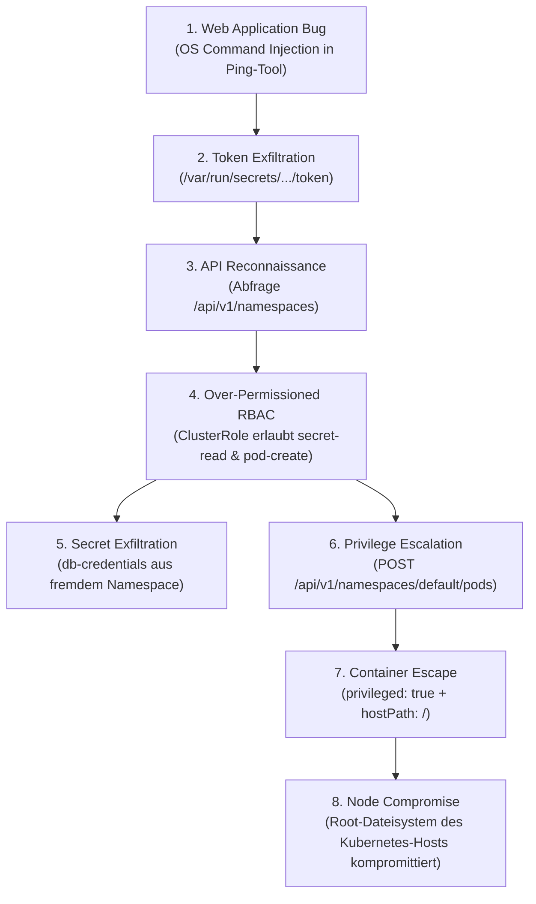

# DevSecOps 12: Kubernetes Security (Attack Chain, RBAC Hardening, Node Escape & Kubescape)

Themenschwerpunkte dieser Session sind die praktische Analyse und Abwehr realistischer Sicherheitsrisiken in Kubernetes-Umgebungen. Anhand eines durchgängigen Angriffsszenarios wird demonstriert, wie eine scheinbar isolierte Anwendungs-Schwachstelle (**OS Command Injection**) in Kombination mit überprivilegierten **ServiceAccounts** und fehlenden **Pod Security Standards** zu einer vollständigen Kompromittierung des zugrunde liegenden Kubernetes-Nodes führt. Zudem werden Gegenmaßnahmen wie **RBAC Least Privilege**, **NetworkPolicies**, **Pod Security Restrictions** sowie statische Sicherheitsanalysen (**Shift-Left Security**) mit **Kubescape** behandelt.

---

## Übersicht der Dateien

| Datei | Beschreibung |
| --- | --- |
| [`00_env_variables.sh`](./00_env_variables.sh) | Zentrale Umgebungsvariablen (`APP_HOST`, Namespaces, ServiceAccounts, Ressourcennamen) |
| [`01_git_clone_repo.sh`](./01_git_clone_repo.sh) | Klonen des Referenz-Labors (`k8s-security-lab`) und Wechsel in das Verzeichnis |
| [`02_setup_environment.sh`](./02_setup_environment.sh) | Vollständige Initialisierung des Minikube-Clusters (Calico CNI) und Ausrollen aller Manifeste |
| [`03_port_forward_dashboard.sh`](./03_port_forward_dashboard.sh) | Port-Forwarding des internen Diagnosetools (`cluster-health-dashboard`) auf Port 5000 |
| [`04_exploit_command_injection_rce.sh`](./04_exploit_command_injection_rce.sh) | Demonstration der OS Command Injection Schwachstelle (`whoami`, `id`) via Ping-Funktion |
| [`05_exfiltrate_service_account_identity.sh`](./05_exfiltrate_service_account_identity.sh) | Exfiltration des gemounteten ServiceAccount-Tokens und des Namespace-Namens |
| [`06_query_kubernetes_api_via_injection.sh`](./06_query_kubernetes_api_via_injection.sh) | Direkte Abfrage des Kubernetes API-Servers (`/api/v1/namespaces`) mit dem gestohlenen Token |
| [`07_rbac_privilege_audit_can_i.sh`](./07_rbac_privilege_audit_can_i.sh) | RBAC-Auditierung mit `kubectl auth can-i` zur Aufdeckung übermäßiger Secret-Leserechte |
| [`08_exfiltrate_database_secret.sh`](./08_exfiltrate_database_secret.sh) | Unberechtigtes Auslesen und Base64-Dekodieren des Secrets `db-credentials` aus dem Namespace `database` |
| [`09_rbac_remediation_hardening.sh`](./09_rbac_remediation_hardening.sh) | Behebung der RBAC-Fehlkonfiguration: Löschen der ClusterRole und Durchsetzen einer namespaced Role |
| [`10_privilege_escalation_create_node_pod.sh`](./10_privilege_escalation_create_node_pod.sh) | Privilege Escalation: Erstellung eines bösartigen privilegierten Pods mit Host-Dateisystem-Mount |
| [`11_verify_and_wait_exploit_pod.sh`](./11_verify_and_wait_exploit_pod.sh) | Überprüfung des erstellten Exploit-Pods (`pwned-via-rbac`) und Warten auf den Zustand `Ready` |
| [`12_verify_node_breakout.sh`](./12_verify_node_breakout.sh) | Nachweis des erfolgreichen Container Escapes direkt auf dem Host-Dateisystem via `minikube ssh` |
| [`13_cleanup_exploit_pod.sh`](./13_cleanup_exploit_pod.sh) | Bereinigung des kompromittierenden Pods aus dem Cluster |
| [`14_install_kubescape.sh`](./14_install_kubescape.sh) | Installation des Kubernetes Security & Compliance Scanners `kubescape` |
| [`15_kubescape_scan_nsa_compliance.sh`](./15_kubescape_scan_nsa_compliance.sh) | Statische Analyse (Shift-Left) aller Manifeste nach dem NSA/CISA Kubernetes Hardening Framework |
| [`16_cloud_metadata_imds_exfiltration.sh`](./16_cloud_metadata_imds_exfiltration.sh) | Exfiltration simulierter Azure Instance Metadata Service (IMDS) Daten über die Command Injection |
| [`17_teardown_environment.sh`](./17_teardown_environment.sh) | Vollständiges Herunterfahren und Bereinigen der Laborumgebung (`minikube delete`) |
| [`18_demo_rbac_can_i_standalone.sh`](./18_demo_rbac_can_i_standalone.sh) | *(Standalone Demo)* Verfeinerung von RBAC-Verben (`list` vs. `get`) und Verifikation von API-Verboten |
| [`19_demo_network_policy_isolation.sh`](./19_demo_network_policy_isolation.sh) | *(Standalone Demo)* Durchsetzung von Mandanten-Isolation: Flaches Netzwerk → Default-Deny → Scoped Allow |
| [`20_demo_pod_security_restricted_vs_privileged.sh`](./20_demo_pod_security_restricted_vs_privileged.sh) | *(Standalone Demo)* Gegenüberstellung von Restricted Pods (`Permission denied`) und Privileged Pods |

---

## Workflow & Erläuterungen

### 1. Die kontinuierliche Angriffskette (The Attack Chain)

In modernen Container-Umgebungen scheitert Sicherheit selten an einer einzelnen Komponente, sondern an der Verkettung scheinbar kleiner Schwachstellen.



#### Schritt-für-Schritt-Ablauf:
1. **Initial Access**: Die Webanwendung (*Cluster Health Dashboard*) verarbeitet Benutzereingaben unvalidiert in einer Shell (`ping -c 1 <host>`). Durch Übergabe von `; whoami; id` erlangt ein Angreifer Remote Code Execution (RCE) im Container-Kontext.
2. **Credential Theft**: Kubernetes bindet standardmäßig in jeden Pod die Zugangsdaten seines ServiceAccounts unter `/var/run/secrets/kubernetes.io/serviceaccount/` ein. Über die Befehlsinjektion liest der Angreifer das JWT-Bearer-Token (`token`) sowie den Namespace aus.
3. **Internal API Interaction**: Unter Verwendung des gestohlenen Tokens spricht der Angreifer den internen API-Server (`https://kubernetes.default.svc`) direkt aus dem kompromittierten Container an.
4. **Secret Theft über Namespace-Grenzen**: Weil dem ServiceAccount fälschlicherweise eine `ClusterRole` zugewiesen wurde (häufige Fehlpraxis durch Wiederverwendung von CI/CD-Accounts), kann er Secrets im fremden Namespace `database` auslesen.
5. **Escape zum Host-Node**: Da der Account zudem Pods erstellen darf (`create pods`), postet der Angreifer ein privilegiertes Pod-Manifest (`privileged: true`) mit Host-Mount (`hostPath: /`). Der neue Pod schreibt eine Datei auf den echten Node – der Container-Ausbruch ist vollzogen.

---

### 2. RBAC: Least Privilege vs. Fehlkonfigurationen

Kubernetes steuert Zugriffsrechte über **Role-Based Access Control (RBAC)**:

- **Roles vs. ClusterRoles**:
  - Eine `Role` gilt **ausschließlich** innerhalb eines definierten Namespaces.
  - Eine `ClusterRole` gilt **clusterweit** über alle Namespaces hinweg (oder für nicht-namespaced Ressourcen wie Nodes und PVs).
- **Die Pop-Quiz-Fehlkonfiguration**:
  Wird eine `ClusterRole` über ein `ClusterRoleBinding` an einen Anwendungs-ServiceAccount (`app-sa`) gebunden, erbt dieser weitreichende Privilegien im gesamten Cluster.
- **Auditierung mit `kubectl auth can-i`**:
  Ermöglicht Administratoren und Testern die Simulation von Berechtigungsprüfungen:
  ```bash
  kubectl auth can-i get secrets --as=system:serviceaccount:default:app-sa -n database
  ```
- **Remediation & Härtung**:
  Löschen der `ClusterRole` und Ersetzen durch eine namespaced `Role`, die strikt auf die tatsächlich benötigten Ressourcen beschränkt ist:
  ```yaml
  apiVersion: rbac.authorization.k8s.io/v1
  kind: Role
  metadata:
    name: app-reader-fixed
    namespace: default
  rules:
  - apiGroups: [""]
    resources: ["pods"]
    verbs: ["get"]
  ```

---

### 3. Container-Isolation & Pod Security Standards

Container teilen sich denselben Kernel mit dem Host-Betriebssystem. Sicherheit basiert auf Kernel-Mechanismen wie **Namespaces** und **cgroups**.

- **Privileged Containers (`privileged: true`)**:
  Schaltet nahezu alle Kernel-Sicherheitsgrenzen und Linux Capabilities frei. Der Container erhält dieselben Zugriffsrechte auf Kernel und Hardware wie Root auf dem Host.
- **HostPath-Mounts (`hostPath: /`)**:
  Bindet Verzeichnisse des physischen/virtuellen Knotens in den Container ein. In Kombination mit privilegierten Rechten ermöglicht dies das Modifizieren von `/etc/shadow`, Crontabs oder Binaries auf dem Host.
- **Gegenmaßnahmen (Pod Security Standards / Admission)**:
  - Durchsetzung des Profils `restricted` oder `baseline` via Kubernetes Pod Security Admission (PSA).
  - Deaktivieren von `allowPrivilegeEscalation: false`.
  - Ausführung als unprivilegierter Non-Root-User (`runAsNonRoot: true`).
  - Read-Only-Root-Filesystem (`readOnlyRootFilesystem: true`).

---

### 4. Cloud Metadata Schutz & SSRF (IMDS)

In Cloud-Umgebungen (wie Azure AKS oder AWS EKS) stellt die Cloud-Plattform unter der Link-Local-IP `169.254.169.254` den **Instance Metadata Service (IMDS)** bereit:

- **Risiko**:
  Kann ein kompromittierter Container oder eine SSRF-Schwachstelle diesen Endpunkt anfragen, können Metadaten der virtuellen Maschine, Netzwerkkonfigurationen und vor allem **Entra ID Access Tokens** von System-Assigned Managed Identities gestohlen werden.
- **Gegenmaßnahmen**:
  - Einsatz von **Azure Workload Identity** anstelle von VM-weiten Kubelet Managed Identities.
  - Blockieren des Zugriffs auf `169.254.169.254` mittels `NetworkPolicy` für reguläre Anwendungs-Pods.

---

### 5. Shift-Left Security mit Kubescape

Sicherheitsüberprüfungen sollten so früh wie möglich im Entwicklungszyklus (**Shift-Left**) verankert werden, bevor Manifeste in Cluster ausgerollt werden.

- **Was ist Kubescape?**:
  Ein Open-Source-Compliance- und Security-Tool, das Kubernetes-Manifeste, Helm Charts und Live-Cluster auf Sicherheitslücken und Konfigurationsfehler untersucht.
- **NSA/CISA Hardening Framework**:
  Prüft u. a. auf:
  - Verwendung privilegierter Container
  - Unverschlüsselte bzw. fest verdrahtete Secrets
  - Fehlende CPU-/Memory-Resource-Limits
  - Fehlende NetworkPolicies
  - Root-Container-Ausführung
- **Automatisierung**:
  In CI/CD-Pipelines (z. B. GitHub Actions oder GitLab CI) führt `kubescape scan framework nsa .` dazu, dass risikobehaftete Commits vor dem Rollout abgewiesen werden.

---

### 6. Netzwerk-Segmentierung mit NetworkPolicies

Standardmäßig ist das Kubernetes-Netzwerk flach und unbeschränkt (*all-to-all* Kommunikation über alle Namespaces hinweg):

- **Calico CNI**:
  Standard-Minikube-Treiber ignorieren `NetworkPolicy`-Objekte. Durch Starten von Minikube mit `--cni=calico` werden NetworkPolicies auf iptables/eBPF-Ebene durchgesetzt.
- **Zero-Trust Best Practice**:
  1. **Default-Deny Ingress/Egress**: Standardmäßig jeglichen Datenverkehr im Namespace blockieren.
  2. **Scoped Allow**: Nur explizit benötigte Pod-zu-Pod-Verbindungen basierend auf Label-Selektoren und Portfreigaben erlauben.
