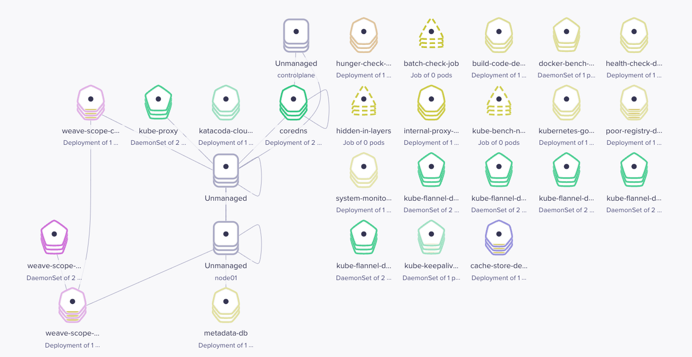
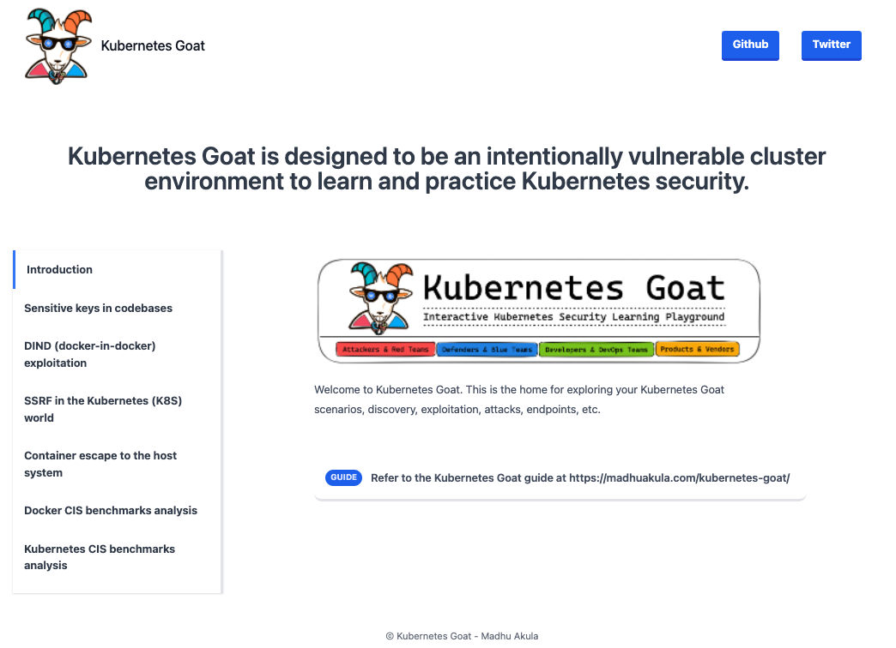
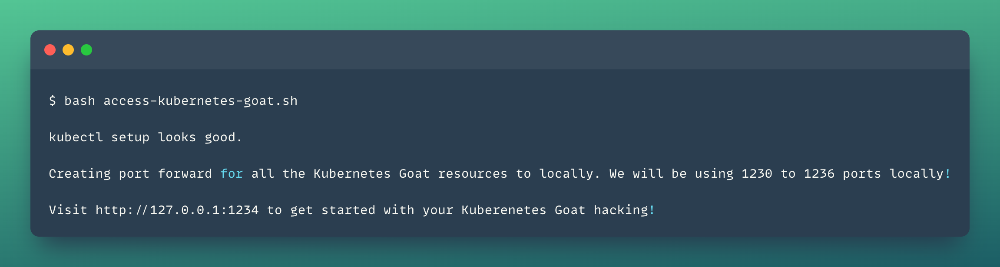
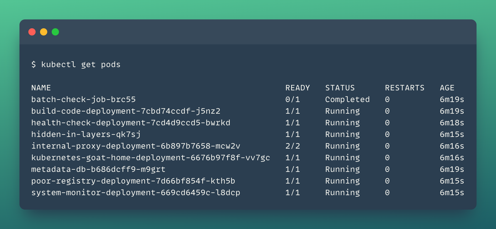

# DevSecOps 13: Kubernetes Goat – Interaktives Kubernetes Security Lab (22 Szenarien)

Themenschwerpunkt dieser Session ist das **Kubernetes Goat** Security Lab von Madhu Akula – eine bewusst verwundbare Kubernetes-Umgebung zum praxisnahen Erlernen von Angriffsmustern, Container-Sicherheit, Cluster-Auditing und Runtime-Defense. Nach der verifizierten Installation von **Helm v3**, **kubectl** und **Minikube** werden alle Szenario-Workloads ausgerollt, über Port-Forwarding (`1230`–`1236`) lokal zugänglich gemacht und anhand von **22 strukturierten Security-Szenarien** systematisch analysiert und gehärtet.

> [!TIP]
> Die ausgearbeiteten **Lösungswege (Solutions)**, Befehle, Bilder und Gegenmaßnahmen zu allen 22 Szenarien befinden sich einzeln aufgeteilt im Unterordner [`solutions/`](./solutions/README.md).

---

## Übersicht der Dateien

| Datei / Ordner | Beschreibung |
| --- | --- |
| [`solutions/`](./solutions/README.md) | **Vollständige Solutions (`scenario-01.md` – `scenario-22.md`)** inkl. Kurzinfo, Befehlen, Abbildungen & Hardening |
| [`00_env_variables.sh`](./00_env_variables.sh) | Zentrale Umgebungsvariablen (`KUBEGOAT_REPO`, `HELM_BUILDKITE_APT_KEY_ID`, `MINIKUBE_DRIVER`) |
| [`01_git_clone_kubernetes_goat.sh`](./01_git_clone_kubernetes_goat.sh) | Klonen des offiziellen `kubernetes-goat`-Repositories und Wechsel ins Projektverzeichnis |
| [`02_install_helm.sh`](./02_install_helm.sh) | Sichere Installation von Helm v3 inkl. GPG-Fingerprint-Prüfung des Buildkite-APT-Keys |
| [`03_install_kubectl.sh`](./03_install_kubectl.sh) | Download der aktuellen stabilen `kubectl`-Binary und der zugehörigen SHA256-Prüfsumme |
| [`04_install_and_start_minikube.sh`](./04_install_and_start_minikube.sh) | Download/Installation von `minikube` und Start des lokalen Clusters (`--driver=docker`) |
| [`05_setup_kubernetes_goat.sh`](./05_setup_kubernetes_goat.sh) | Setzen der Ausführungsrechte und Rollout aller verwundbaren Manifeste & Helm-Charts |
| [`06_access_kubernetes_goat.sh`](./06_access_kubernetes_goat.sh) | Einrichtung der Port-Forwardings (`1230`–`1236`) nach Readiness-Check der Pods |
| [`07_teardown_kubernetes_goat.sh`](./07_teardown_kubernetes_goat.sh) | Rückstandsfreie Entfernung aller Kubernetes-Goat-Ressourcen und Helm-Releases |

---

## Architektur, Setup & Port-Mapping

Nach dem Start von Minikube (`minikube start --driver=docker`) installiert `setup-kubernetes-goat.sh` die verwundbaren Deployments, Jobs, RBAC-Fehlkonfigurationen sowie das Helm-Chart `metadata-db`. Für Windows-Umgebungen liegen im Repository zusätzlich entsprechende `.ps1`-PowerShell-Skripte vor.

Anschließend prüft `access-kubernetes-goat.sh`, ob alle Ziel-Pods den Status `Running` und `Ready` erreicht haben, und leitet die relevanten Dienste lokal auf die Ports `1230` bis `1236` weiter:

| Lokaler Port | Ziel-Port (Pod) | Deployment / Label | Szenario / Funktion |
| --- | --- | --- | --- |
| `http://127.0.0.1:1230` | `3000` | `app=build-code` | Szenario 1: Sensitive Keys in Codebases (`.git`-Exposure) |
| `http://127.0.0.1:1231` | `80` | `app=health-check` | Szenario 2: DIND / Container-Socket Exploitation |
| `http://127.0.0.1:1232` | `3000` | `app=internal-proxy` | Szenario 3: SSRF im Kubernetes-Cluster |
| `http://127.0.0.1:1233` | `8080` | `app=system-monitor` | Szenario 4 & 12: Container Escape & Environment Info |
| `http://127.0.0.1:1234` | `80` | `app=kubernetes-goat-home` | **Kubernetes Goat Startseite & Navigation** |
| `http://127.0.0.1:1235` | `5000` | `app=poor-registry` | Szenario 7: Offene Private Container Registry |
| `http://127.0.0.1:1236` | `8080` | `app=hunger-check` (`big-monolith`) | Szenario 13 & 16: Resource DoS & RBAC Least Privilege |









---

## Kompaktes Docker & Kubernetes Cheat Sheet

### Docker-Befehle
```bash
docker version                          # Docker-Client- und Server-Version prüfen
docker ps -a                            # Alle laufenden und beendeten Container auflisten
docker images                           # Lokal vorhandene Images anzeigen
docker info                             # Systemweite Docker-Informationen abrufen
docker run -it alpine sh                # Interaktiven Alpine-Container starten
docker exec -it <CONTAINER> sh          # Shell in einem laufenden Container öffnen
docker inspect <CONTAINER_ODER_IMAGE>   # Detaillierte JSON-Metadaten auslesen
docker history --no-trunc <IMAGE>       # Vollständige Layer-Historie ohne Kürzung prüfen
```

### Kubernetes-Befehle (`kubectl`)
```bash
kubectl version                         # Client- und Cluster-Version prüfen
kubectl cluster-info                    # Endpunkte von API-Server und CoreDNS anzeigen
kubectl get nodes -o wide               # Nodes inkl. interner/externer IPs auflisten
kubectl get pods,svc,ns,deploy,secrets  # Mehrere Ressourcentypen kompakt abfragen
kubectl get pods -n <NAMESPACE>         # Pods eines bestimmten Namespaces auflisten
kubectl describe pod <PODNAME>          # Events, Mounts und Container-Status prüfen
kubectl logs -f <PODNAME>               # Live-Logs eines Pods verfolgen
kubectl exec -it <PODNAME> -- sh        # Interaktive Shell im Pod öffnen
kubectl port-forward <PODNAME> 1234:80  # Lokales Port-Forwarding zu einem Pod
kubectl auth can-i create pods          # Eigene RBAC-Berechtigungen testen
kubectl get pod <PODNAME> -o yaml       # Vollständiges Pod-Manifest als YAML exportieren
kubectl api-resources                   # Alle verfügbaren Kubernetes API-Ressourcen anzeigen
```

---

## Übersicht der 22 Szenarien (Kurzinfo & Links zu den Solutions)

| # | Szenario | Sicherheitsdomäne | Kurzbeschreibung | Solution |
| --- | --- | --- | --- | --- |
| 1 | Sensitive Keys in Codebases | Secrets & Supply Chain | Exponiertes `.git`-Verzeichnis und Secret-Suche mit `git-dumper` & `trufflehog` | [Lösung 01](./solutions/scenario-01.md) |
| 2 | DIND (Docker-in-Docker) Exploitation | Container Escape & Runtime | Command Injection + gemounteter `containerd.sock` via `crictl` | [Lösung 02](./solutions/scenario-02.md) |
| 3 | SSRF in the Kubernetes World | Netzwerk & SSRF | Abfrage interner Dienste (`metadata-db`) über Cluster-DNS per SSRF | [Lösung 03](./solutions/scenario-03.md) |
| 4 | Container Escape to the Host System | Container Escape & Runtime | Ausbruch über privilegierten Container & `hostPath`-Mount (`/host-system`) | [Lösung 04](./solutions/scenario-04.md) |
| 5 | Docker CIS Benchmarks Analysis | Auditing & Observability | DaemonSet-Audit der Docker-Konfiguration mit `docker-bench-security` | [Lösung 05](./solutions/scenario-05.md) |
| 6 | Kubernetes CIS Benchmarks Analysis | Auditing & Observability | Control-Plane- & Node-Audit via `kube-bench` Kubernetes Jobs | [Lösung 06](./solutions/scenario-06.md) |
| 7 | Attacking Private Container Registry | Secrets & Supply Chain | Unauthentifizierte Registry HTTP API v2 (`/v2/_catalog`) & Manifest-Analyse | [Lösung 07](./solutions/scenario-07.md) |
| 8 | NodePort Exposed Services | Netzwerk & SSRF | Direkter Zugriff auf interne Dienste über offene NodePorts (`30000`–`32767`) | [Lösung 08](./solutions/scenario-08.md) |
| 9 | Helm v2 Tiller *(Deprecated)* | RBAC & Admission Control | Historischer Cluster-Takeover über unauthentifizierten Helm-v2-Tiller | [Lösung 09](./solutions/scenario-09.md) |
| 10 | Analyzing Crypto Miner Container | Secrets & Supply Chain | Erkennung bösartiger Build-Befehle über `docker history --no-trunc` | [Lösung 10](./solutions/scenario-10.md) |
| 11 | Kubernetes Namespaces Bypass | Netzwerk & SSRF | Zugriff auf Redis in `secure-middleware` aus `default` im Flachnetzwerk | [Lösung 11](./solutions/scenario-11.md) |
| 12 | Gaining Environment Information | Secrets & Supply Chain | Auslesen von Secrets aus `ENV`-Variablen (`printenv`) & Runtime-Infos | [Lösung 12](./solutions/scenario-12.md) |
| 13 | DoS the Memory/CPU Resources | Verfügbarkeit & Ressourcen | Ressourcen-Erschöpfung via `stress-ng` bei fehlenden `limits` | [Lösung 13](./solutions/scenario-13.md) |
| 14 | Hacker Container Preview | Container Escape & Runtime | Einsatz von `madhuakula/hacker-container` (`amicontained`, `nikto.pl`) | [Lösung 14](./solutions/scenario-14.md) |
| 15 | Hidden in Layers | Secrets & Supply Chain | Wiederherstellung gelöschter Secrets aus Docker-Image-Layern (`layer.tar`) | [Lösung 15](./solutions/scenario-15.md) |
| 16 | RBAC Least Privileges Misconfiguration | RBAC & Admission Control | API-Server-Abfrage mit überprivilegiertem ServiceAccount-Token | [Lösung 16](./solutions/scenario-16.md) |
| 17 | KubeAudit – Audit Kubernetes Clusters | Auditing & Observability | Cluster-weiter Security-Scan auf Root/Privileges mit `kubeaudit all` | [Lösung 17](./solutions/scenario-17.md) |
| 18 | Falco – Runtime Security Monitoring | Auditing & Observability | Kernel-Syscall-Erkennung verdächtiger Aktivitäten mit `Falco` | [Lösung 18](./solutions/scenario-18.md) |
| 19 | Popeye – Kubernetes Cluster Sanitizer | Auditing & Observability | Live-Cluster-Hygiene-Check & Best-Practice-Scoring mit `popeye` | [Lösung 19](./solutions/scenario-19.md) |
| 20 | Secure Network Boundaries (NSP) | Netzwerk & SSRF | Isolation von Workloads mittels Ingress-Deny-`NetworkPolicy` | [Lösung 20](./solutions/scenario-20.md) |
| 21 | Cilium Tetragon (eBPF Observability) | Auditing & Observability | eBPF-Runtime-Monitoring und `nsenter`-Escape-Detektion mit `tetra` | [Lösung 21](./solutions/scenario-21.md) |
| 22 | Kyverno Policy Engine | RBAC & Admission Control | Blockieren von `kubectl exec` im Namespace `vault` via `ClusterPolicy` | [Lösung 22](./solutions/scenario-22.md) |
