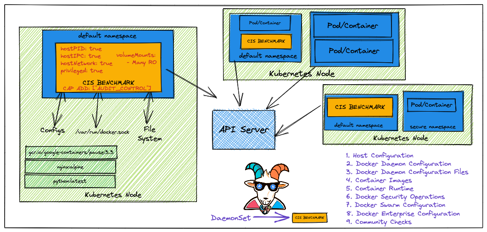
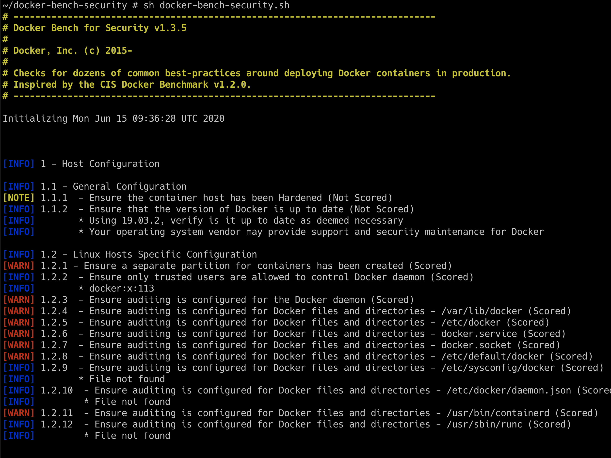

# Szenario 05 – Docker CIS Benchmarks Analysis

- **Kategorie**: Auditing & Observability
- **Zielressource**: DaemonSet `docker-bench-security` (`scenarios/docker-bench-security/deployment.yaml`)

## Kurzinfo & Risiko
Ohne regelmäßige Konfigurations-Audits bleiben unsichere Docker-Daemon-Einstellungen und fehlende Container-Restriktionen auf Worker-Nodes unentdeckt.



## Solution
```bash
# DaemonSet ausrollen und laufenden Pod ermitteln
kubectl apply -f scenarios/docker-bench-security/deployment.yaml
kubectl get pods

# In den Pod wechseln und CIS-Benchmark starten
kubectl exec -it docker-bench-security-xxxxx -- sh
cd docker-bench-security
sh docker-bench-security.sh
```



## Gegenmaßnahmen
- Gemeldete `[WARN]`-Befunde beheben und CIS-Checks automatisiert in das Host-Hardening aufnehmen.

---
[← Vorheriges Szenario](./scenario-04.md) | [Solutions-Übersicht](./README.md) | [Nächstes Szenario →](./scenario-06.md)
