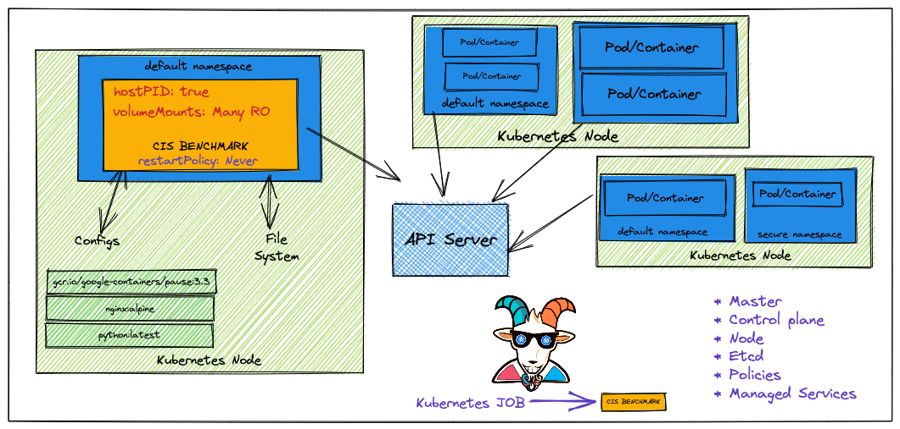
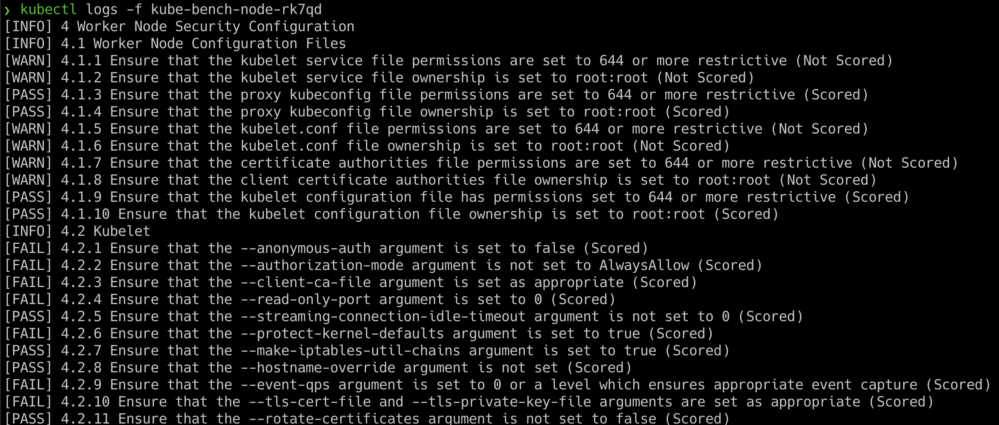

# Szenario 06 – Kubernetes CIS Benchmarks Analysis

- **Kategorie**: Auditing & Observability
- **Zielressource**: Kubernetes Jobs (`scenarios/kube-bench-security/node-job.yaml`, `master-job.yaml`)

## Kurzinfo & Risiko
Fehlkonfigurationen an Control-Plane-Komponenten (`kube-apiserver`, `etcd`, `kubelet`) können anonyme API-Zugriffe oder schwache TLS-Einstellungen ermöglichen.



## Solution
```bash
# kube-bench Jobs für Node und Master ausrollen
kubectl apply -f scenarios/kube-bench-security/node-job.yaml
kubectl apply -f scenarios/kube-bench-security/master-job.yaml

# Jobs und Pod-Namen prüfen, anschließend Logs auslesen
kubectl get jobs
kubectl get pods
kubectl logs -f kube-bench-node-xxxxx
```



## Gegenmaßnahmen
- Control-Plane- und Kubelet-Flags gemäß CIS Kubernetes Benchmark härten (anonyme Auth deaktivieren, RBAC aktivieren, Zertifikate rotieren).

---
[← Vorheriges Szenario](./scenario-05.md) | [Solutions-Übersicht](./README.md) | [Nächstes Szenario →](./scenario-07.md)
