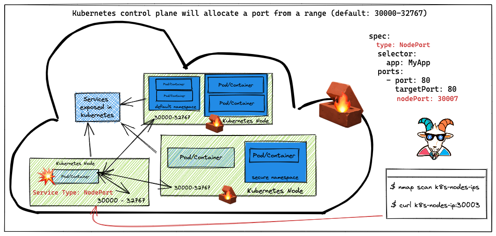
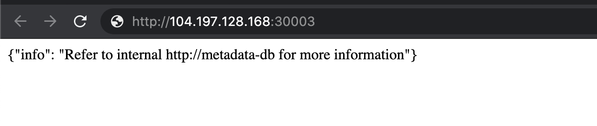

# Szenario 08 – NodePort Exposed Services

- **Kategorie**: Netzwerk & SSRF
- **Zielressource**: Externe Node-IPs & NodePort-Bereich (`30000`–`32767`)

## Kurzinfo & Risiko
Dienste vom Typ `NodePort` öffnen standardmäßig Ports im Bereich `30000`–`32767` auf allen Cluster-Nodes. Ohne Firewall-Schutz sind interne Services dadurch direkt von außen erreichbar.



## Solution
```bash
# Externe IP-Adressen der Cluster-Nodes ermitteln
kubectl get nodes -o wide

# Offenen NodePort (nach Port-Scan z. B. mit nmap) prüfen
nc -zv EXTERNAL-IP-ADDRESS 30003
```



## Gegenmaßnahmen
- Interne Dienste als `ClusterIP` betreiben, kontrollierte Ingress/LoadBalancer-Endpunkte nutzen und NodePort-Bereiche per Firewall/NSG blockieren.

---
[← Vorheriges Szenario](./scenario-07.md) | [Solutions-Übersicht](./README.md) | [Nächstes Szenario →](./scenario-09.md)
