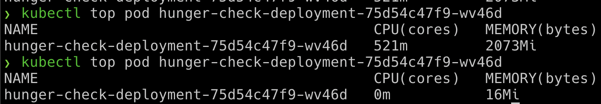

# Szenario 13 – DoS the Memory/CPU Resources

- **Kategorie**: Verfügbarkeit & Ressourcen
- **Einstieg**: `http://127.0.0.1:1236` (Pod `hunger-check-deployment-*` im Namespace `big-monolith`)

## Kurzinfo & Risiko
Fehlen `requests` und `limits` im Deployment (und ein `LimitRange` im Namespace), kann ein einzelner Pod unbegrenzt Arbeitsspeicher/CPU verbrauchen und andere Workloads verdrängen.

## Solution
```bash
# Im Container: 2 GB RAM für 30s auslasten
stress-ng --vm 2 --vm-bytes 2G --timeout 30s

# Auf dem Host: Ressourcenverbrauch des Pods beobachten
kubectl --namespace big-monolith top pod hunger-check-deployment-xxxxxxxxxx-xxxxx
```



## Gegenmaßnahmen
- CPU-/Memory-`requests` und `limits` in jedem Pod-Manifest definieren sowie `LimitRange` und `ResourceQuota` auf Namespace-Ebene erzwingen.

---
[← Vorheriges Szenario](./scenario-12.md) | [Solutions-Übersicht](./README.md) | [Nächstes Szenario →](./scenario-14.md)
