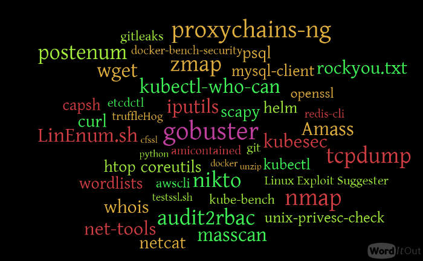
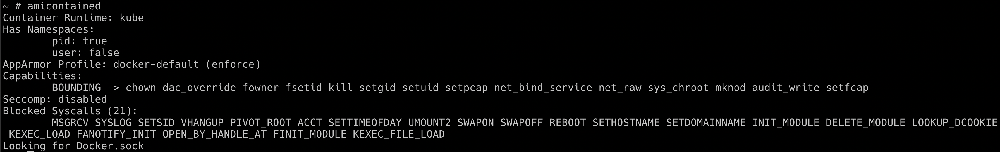

# Szenario 14 – Hacker Container Preview

- **Kategorie**: Container Escape & Runtime
- **Zielressource**: Tooling-Container `madhuakula/hacker-container`

## Kurzinfo & Risiko
Zeigt, wie ein vorkonfigurierter Pentesting-Container (`madhuakula/hacker-container`) zur Selbstprüfung von Container-Capabilities (`amicontained`) und internen Web-Scans (`nikto.pl`) genutzt werden kann.



## Solution
```bash
kubectl run -it hacker-container --image=madhuakula/hacker-container -- sh
amicontained
nikto.pl -host http://metadata-db
```



## Gegenmaßnahmen
- Ausführung nicht autorisierter Images per Admission Policy blockieren und ausgehenden Pod-Traffic per `NetworkPolicy` einschränken.

---
[← Vorheriges Szenario](./scenario-13.md) | [Solutions-Übersicht](./README.md) | [Nächstes Szenario →](./scenario-15.md)
