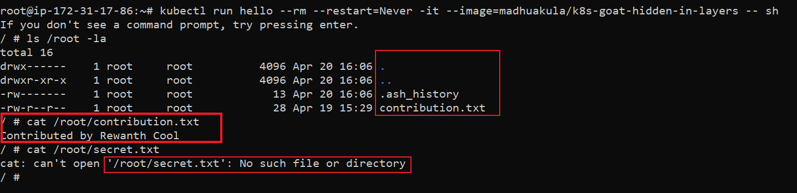
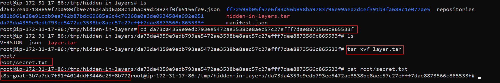

# Szenario 15 – Hidden in Layers

- **Kategorie**: Secrets & Supply Chain
- **Zielressource**: Job `hidden-layers`, Image `madhuakula/k8s-goat-hidden-in-layers`

## Kurzinfo & Risiko
Dateien, die während `docker build` in einem Layer angelegt und in einem späteren Layer gelöscht werden, bleiben im zugrunde liegenden Image-Tar-Archiv vollständig erhalten.

## Solution
```bash
kubectl get jobs
docker inspect madhuakula/k8s-goat-hidden-in-layers
docker history --no-trunc madhuakula/k8s-goat-hidden-in-layers

# Optional: Dockerfile rekonstruieren
alias dfimage="docker run -v /var/run/docker.sock:/var/run/docker.sock --rm alpine/dfimage"
dfimage -sV=1.36 madhuakula/k8s-goat-hidden-in-layers

# Image exportieren und betroffenen Layer entpacken
docker save madhuakula/k8s-goat-hidden-in-layers -o hidden-in-layers.tar
tar -xvf hidden-in-layers.tar
cd da73da4359e9edb793ee5472ae3538be8aec57c27efff7dae8873566c865533f
tar -xvf layer.tar
cat root/secret.txt
```





## Gegenmaßnahmen
- Secrets niemals in Build-Schritten ins Image schreiben; stattdessen Multi-Stage-Builds oder BuildKit-Secret-Mounts (`--mount=type=secret`) verwenden.

---
[← Vorheriges Szenario](./scenario-14.md) | [Solutions-Übersicht](./README.md) | [Nächstes Szenario →](./scenario-16.md)
