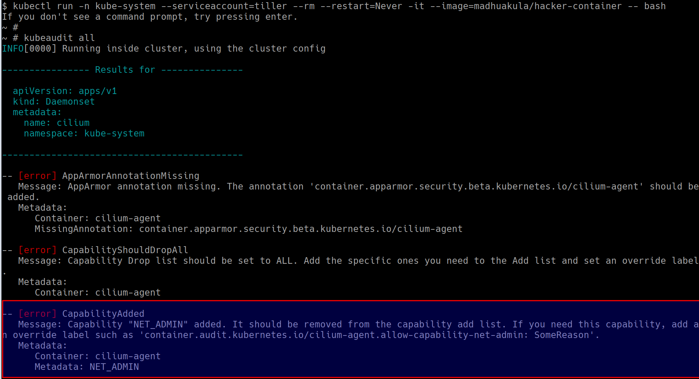

# Szenario 17 – KubeAudit – Audit Kubernetes Clusters

- **Kategorie**: Auditing & Observability
- **Zielressource**: Cluster-weiter Scan aus einem Container mit `tiller`-ServiceAccount (`kube-system`)

## Kurzinfo & Risiko
Automatisierter Cluster-Scan mit **KubeAudit** zur Erkennung von Root-Containern, beschreibbaren Dateisystemen, gefährlichen Capabilities und privilegierten Pods.

## Solution
```bash
kubectl run -n kube-system --serviceaccount=tiller --rm --restart=Never -it --image=madhuakula/hacker-container -- bash
kubeaudit all
```



## Gegenmaßnahmen
- `runAsNonRoot: true`, `readOnlyRootFilesystem: true`, `capabilities.drop: ["ALL"]` und `privileged: false` konsequent umsetzen.

---
[← Vorheriges Szenario](./scenario-16.md) | [Solutions-Übersicht](./README.md) | [Nächstes Szenario →](./scenario-18.md)
