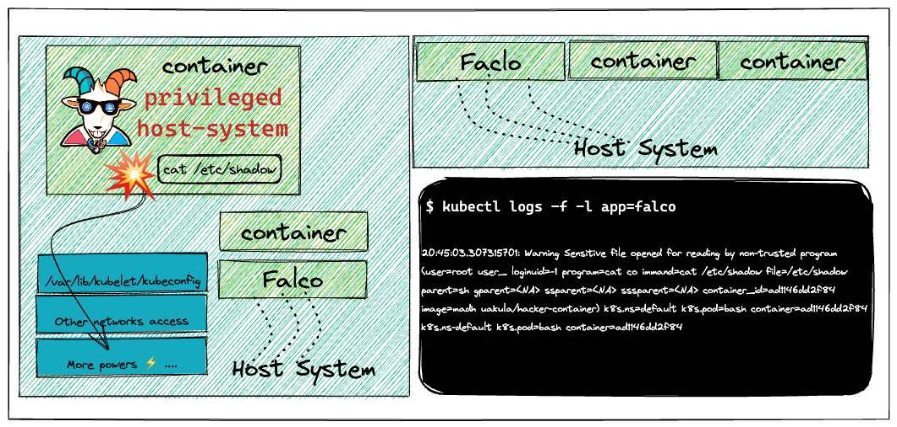
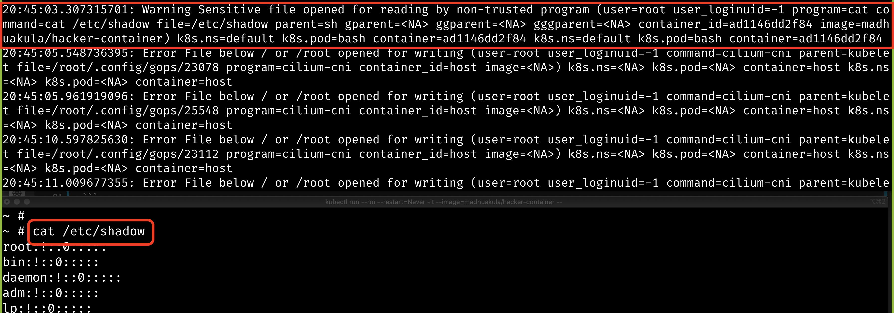

# Szenario 18 – Falco – Runtime Security Monitoring & Detection

- **Kategorie**: Auditing & Observability
- **Zielressource**: DaemonSet `falco` (Helm Chart `falcosecurity/falco`)

## Kurzinfo & Risiko
**Falco** überwacht Linux-Systemaufrufe direkt am Kernel und erkennt Laufzeit-Anomalien (z. B. Zugriff auf `/etc/shadow` oder unerwartete Shells) in Echtzeit.



## Solution
```bash
# Falco via Helm v3 installieren und Logs verfolgen
helm repo add falcosecurity https://falcosecurity.github.io/charts
helm repo update
helm install falco falcosecurity/falco
kubectl get pods --selector app=falco
kubectl logs -f -l app=falco

# In einem zweiten Terminal: verdächtige Aktivität auslösen
kubectl run --rm --restart=Never -it --image=madhuakula/hacker-container -- bash
cat /etc/shadow
```



## Gegenmaßnahmen
- Falco-Alerts zentral an ein SIEM/Alerting-System anbinden und eigene Regelsets für kritische Workloads definieren.

---
[← Vorheriges Szenario](./scenario-17.md) | [Solutions-Übersicht](./README.md) | [Nächstes Szenario →](./scenario-19.md)
