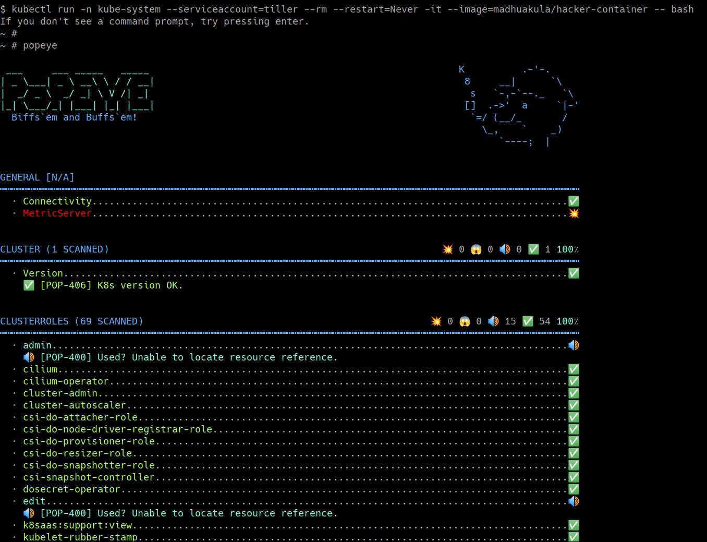

# Szenario 19 – Popeye – Kubernetes Cluster Sanitizer

- **Kategorie**: Auditing & Observability
- **Zielressource**: Cluster-weiter Sanity-Check mit `popeye`

## Kurzinfo & Risiko
**Popeye** prüft Live-Cluster auf Fehlkonfigurationen, ungenutzte Ressourcen und Best-Practice-Abweichungen über alle Cluster-Objekte hinweg.

## Solution
```bash
kubectl run -n kube-system --serviceaccount=tiller --rm --restart=Never -it --image=madhuakula/hacker-container -- bash
popeye
```



## Gegenmaßnahmen
- Regelmäßige Cluster-Hygiene-Audits durchführen und gemeldete Konfigurationsmängel bereinigen.

---
[← Vorheriges Szenario](./scenario-18.md) | [Solutions-Übersicht](./README.md) | [Nächstes Szenario →](./scenario-20.md)
