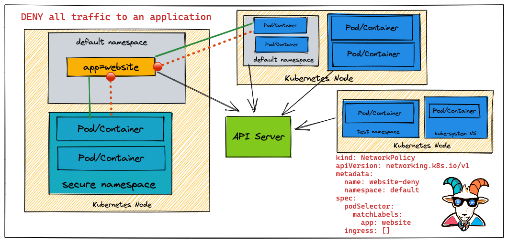
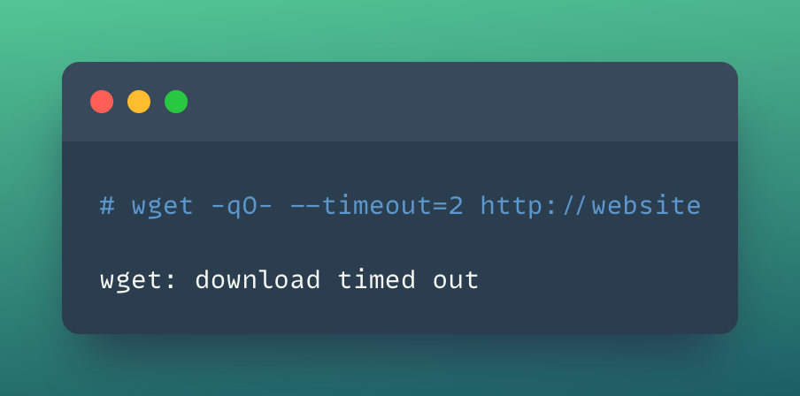

# Szenario 20 – Secure Network Boundaries using Network Security Policy

- **Kategorie**: Netzwerk & SSRF
- **Zielressource**: Workload `website` (Label `app=website`, Port `80`) & `NetworkPolicy` `website-deny`

## Kurzinfo & Risiko
Standardmäßig darf jeder Pod im Cluster mit jedem anderen Pod kommunizieren. Eine `NetworkPolicy` schränkt diesen Datenverkehr gezielt ein.



## Solution
```bash
# Test-Service deployen und Zugriff vorab prüfen
kubectl run --image=nginx website --labels app=website --expose --port 80
kubectl run --rm -it --image=alpine temp -- sh
# Im Alpine-Pod:
wget -qO- http://website
```

```yaml
# website-deny.yaml
kind: NetworkPolicy
apiVersion: networking.k8s.io/v1
metadata:
  name: website-deny
spec:
  podSelector:
    matchLabels:
      app: website
  ingress: []
```

```bash
# Policy anwenden und Blockade testen
kubectl apply -f website-deny.yaml
kubectl run --rm -it --image=alpine temp -- sh
# Im Alpine-Pod (läuft in Timeout):
wget -qO- --timeout=2 http://website

# Bereinigung
kubectl delete pod website
kubectl delete service website
kubectl delete networkpolicy website-deny
```



---
[← Vorheriges Szenario](./scenario-19.md) | [Solutions-Übersicht](./README.md) | [Nächstes Szenario →](./scenario-21.md)
