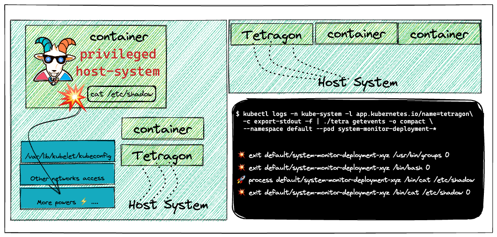
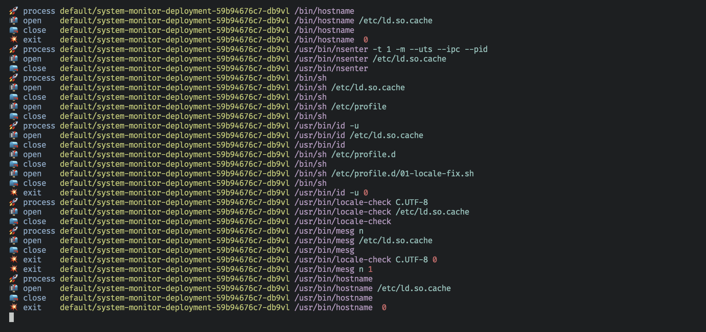

# Szenario 21 – Cilium Tetragon – eBPF Runtime Security Observability

- **Kategorie**: Auditing & Observability
- **Zielressource**: Helm Release `tetragon` (`cilium/tetragon` in `kube-system`), Ziel-Pod `app=system-monitor`

## Kurzinfo & Risiko
**Cilium Tetragon** nutzt eBPF zur tiefen Runtime-Observability und erkennt sowohl Dateizugriffe (`/etc/shadow`) als auch Container-Escapes (`nsenter` auf PID 1) auf Kernel-Ebene.



## Solution
```bash
# Tetragon via Helm v3 bereitstellen
helm repo add cilium https://helm.cilium.io
helm repo update
helm install tetragon cilium/tetragon -n kube-system
kubectl rollout status -n kube-system ds/tetragon -w
kubectl get pods -n kube-system --selector app.kubernetes.io/instance=tetragon

# tetra CLI herunterladen und Events für system-monitor filtern
wget https://github.com/cilium/tetragon/releases/download/v0.9.0/tetra-linux-amd64.tar.gz
tar -xvzf tetra-linux-amd64.tar.gz
kubectl logs -n kube-system -l app.kubernetes.io/name=tetragon -c export-stdout -f | ./tetra getevents -o compact --namespace default --pod system-monitor-deployment-*

# Im zweiten Terminal: Escape & Dateizugriff simulieren
export POD_NAME=$(kubectl get pods -l "app=system-monitor" -o jsonpath="{.items[0].metadata.name}")
kubectl exec -it $POD_NAME -- bash
cat /etc/shadow
nsenter -t 1 -m --uts --ipc --pid
```



## Gegenmaßnahmen
- `TracingPolicy`-Regeln mit aktivem Enforcement (`Sigkill`) konfigurieren, um unautorisierte Escapes und Syscalls sofort zu blockieren.

---
[← Vorheriges Szenario](./scenario-20.md) | [Solutions-Übersicht](./README.md) | [Nächstes Szenario →](./scenario-22.md)
