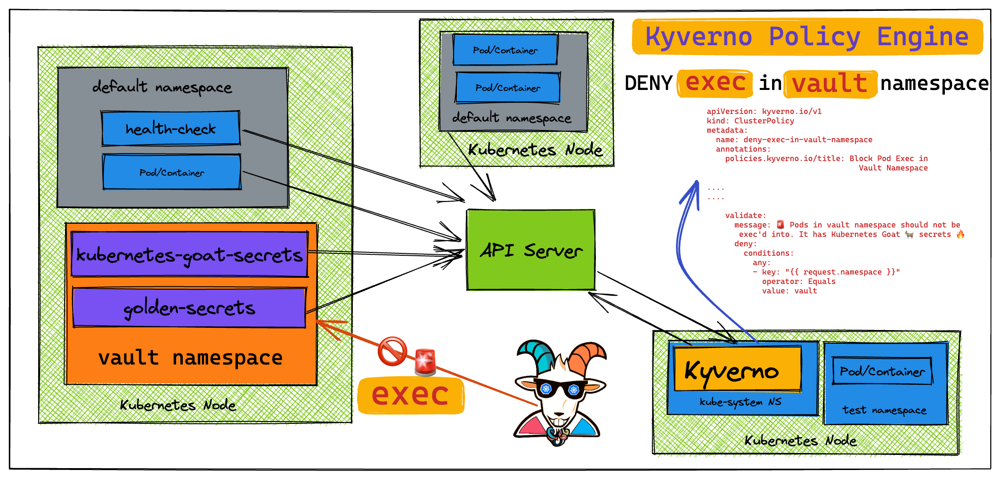
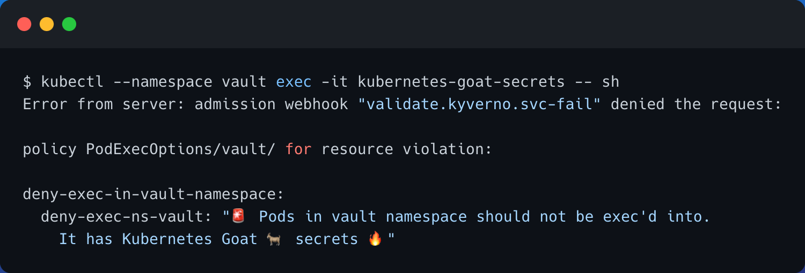

# Szenario 22 – Securing Kubernetes Clusters using Kyverno Policy Engine

- **Kategorie**: RBAC & Admission Control
- **Zielressource**: Namespaces `vault` & `kyverno`, Pod `kubernetes-goat-secrets`, `ClusterPolicy` `deny-exec-in-vault-namespace`

## Kurzinfo & Risiko
Ohne Admission Control können autorisierte Benutzer per `kubectl exec` Shells in sensiblen Pods (z. B. im Namespace `vault`) öffnen. **Kyverno** blockiert solche API-Requests deklarativ am API-Server.



## Solution
```bash
# Namespace & Kyverno bereitstellen
kubectl create namespace vault
helm repo add kyverno https://kyverno.github.io/kyverno/
helm repo update
helm install kyverno kyverno/kyverno -n kyverno --create-namespace

# Test-Pod starten und exec vor Policy-Aktivierung prüfen
kubectl --namespace vault run kubernetes-goat-secrets --image=madhuakula/k8s-goat-info-app --port=5000 --restart=Never
kubectl get pods -n vault
kubectl --namespace vault exec -it kubernetes-goat-secrets -- sh

# ClusterPolicy anwenden und exec-Blockade verifizieren
kubectl apply -f https://raw.githubusercontent.com/madhuakula/kubernetes-goat/master/scenarios/kyverno-namespace-exec-block/kyverno-block-pod-exec-by-namespace.yaml
kubectl get clusterpolicies
kubectl --namespace vault exec -it kubernetes-goat-secrets -- sh

# Bereinigung
kubectl delete clusterpolicy deny-exec-in-vault-namespace
kubectl delete ns vault kyverno
```



## Gegenmaßnahmen
- Kyverno-Policies für Pod-Sicherheit, Image-Verifikation und Exec-Restriktionen im `enforce`-Modus betreiben und in CI/CD vorab testen.

---
[← Vorheriges Szenario](./scenario-21.md) | [Solutions-Übersicht](./README.md)
