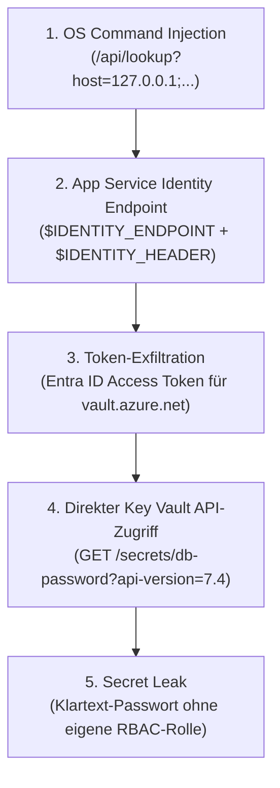

# DevSecOps 14: Modern Application Deployments (Azure Functions, Managed Identity & Key Vault Secret Leak)

Themenschwerpunkte dieser Session sind serverlose Anwendungs-Deployments mit **Azure Functions (Python 3.11, Consumption Plan)** sowie die Sicherheitsrisiken rund um **Managed Identities** bei Anwendungsschwachstellen. Zunächst wird eine klassische Hello-World-Funktion per Zip-Deploy bereitgestellt. Anschließend zeigt das **Key Vault Secret Leak Lab**, wie eine scheinbar isolierte **OS Command Injection** in einer Azure Function dazu missbraucht werden kann, das Entra-ID-Token der zugewiesenen **System-Assigned Managed Identity** über den App-Service-Endpunkt (`IDENTITY_ENDPOINT`) zu stehlen und damit Secrets direkt aus einem RBAC-geschützten **Azure Key Vault** auszulesen.

---

## Übersicht der Dateien

| Datei | Beschreibung |
| --- | --- |
| [`00_env_variables.sh`](./00_env_variables.sh) | Zentrale Umgebungsvariablen für Teil 1 (`RG_HELLO`, `FUNCAPP_HELLO`) und Teil 2 (`RG_KV`, `FUNCAPP_KV`, `KV`) |
| [`01_git_clone_repo.sh`](./01_git_clone_repo.sh) | Klonen des Demo-Repositories (`azure-functions-demos`) und Wechsel in `hello-world` |
| [`02_hello_create_resources.sh`](./02_hello_create_resources.sh) | *(Teil 1)* Erstellung von Resource Group, Storage Account und Linux Python Function App |
| [`03_hello_configure_appsettings.sh`](./03_hello_configure_appsettings.sh) | *(Teil 1)* Konfiguration von Python v2 Worker Indexing und Remote-Build |
| [`04_hello_zip_and_deploy.sh`](./04_hello_zip_and_deploy.sh) | *(Teil 1)* Verpacken des Codes als ZIP und Deployment via `az functionapp deployment source config-zip` |
| [`05_hello_test_endpoint.sh`](./05_hello_test_endpoint.sh) | *(Teil 1)* Testaufruf des HTTP-Triggers (`/api/hello?name=Cybersteps`) |
| [`06_hello_cleanup.sh`](./06_hello_cleanup.sh) | *(Teil 1)* Asynchrones Löschen der Hello-World-Resource-Group |
| [`07_kv_create_resources.sh`](./07_kv_create_resources.sh) | *(Teil 2)* Erstellung von Resource Group, Storage Account, Key Vault (`--enable-rbac-authorization`) und Function App |
| [`08_kv_assign_officer_and_set_secret.sh`](./08_kv_assign_officer_and_set_secret.sh) | *(Teil 2)* Zuweisung von `Key Vault Secrets Officer` an den eigenen Benutzer und Anlage des Demo-Secrets `db-password` |
| [`09_kv_assign_managed_identity.sh`](./09_kv_assign_managed_identity.sh) | *(Teil 2)* Aktivierung der System-Assigned Managed Identity und Vergabe von `Key Vault Secrets User` (Least Privilege) |
| [`10_kv_configure_appsettings.sh`](./10_kv_configure_appsettings.sh) | *(Teil 2)* Setzen von `KEY_VAULT_URL`, `DB_SECRET_NAME` und Deployment-Flags auf der Function App |
| [`11_kv_vendor_deps_and_deploy.sh`](./11_kv_vendor_deps_and_deploy.sh) | *(Teil 2)* Cross-Platform-Vendoring der Python-Pakete (`manylinux2014_x86_64`) und Zip-Deployment |
| [`12_kv_verify_legitimate_endpoints.sh`](./12_kv_verify_legitimate_endpoints.sh) | *(Teil 2)* Verifikation der regulären Endpunkte (`/api/db-status` und `/api/lookup?host=example.com`) |
| [`13_kv_exploit_command_injection.sh`](./13_kv_exploit_command_injection.sh) | *(Teil 2)* Nachweis der OS Command Injection über `/api/lookup?host=127.0.0.1;id` |
| [`14_kv_steal_identity_token.sh`](./14_kv_steal_identity_token.sh) | *(Teil 2)* Exfiltration des Key-Vault-Access-Tokens der Managed Identity über `IDENTITY_ENDPOINT` & `IDENTITY_HEADER` |
| [`15_kv_exfiltrate_secret_with_token.sh`](./15_kv_exfiltrate_secret_with_token.sh) | *(Teil 2)* Direkter Abruf von `db-password` über die Key Vault REST API mit dem gestohlenen Bearer-Token |
| [`16_kv_cleanup.sh`](./16_kv_cleanup.sh) | *(Teil 2)* Asynchrones Löschen der Key-Vault-Lab-Resource-Group |

---

## Workflow & Sicherheitskonzepte

### 1. Serverless Deployment-Pipeline (Azure Functions Python v4)
- **Consumption Plan**: Abrechnung pro Ausführung und Laufzeit ohne dedizierte VM-Verwaltung.
- **Python v2 Programming Model**: Aktivierung über `AzureWebJobsFeatureFlags=EnableWorkerIndexing` erlaubt schlanke Decorator-basierte Trigger (`@app.route(...)`).
- **Dependency Vendoring**: Für Linux-basierte Function Apps werden native Wheels gezielt für `--platform manylinux2014_x86_64` und `--python-version 3.11` in `.python_packages/lib/site-packages` installiert, bevor das ZIP-Archiv hochgeladen wird.

### 2. Angriffskette im Key Vault Secret Leak Lab

Obwohl der Key Vault korrekt über **Azure RBAC** abgesichert ist und die Function App nach dem **Least-Privilege-Prinzip** lediglich die Rolle `Key Vault Secrets User` besitzt, hebelt eine **OS Command Injection** in `/api/lookup` diese Schutzgrenze aus:

### 3. Wichtiges Architektur-Detail: VM IMDS vs. App Service / Functions
- Auf **Azure VMs** werden Managed-Identity-Tokens über die bekannte Link-Local-Adresse `169.254.169.254` (IMDS) abgerufen.
- In **Azure Functions / Azure App Service** (Sandbox-Umgebung) steht diese IP nicht für Identity-Tokens zur Verfügung. Stattdessen injiziert die Plattform zwei lokale Umgebungsvariablen in den App-Prozess:
  - `IDENTITY_ENDPOINT`: Lokaler HTTP-Endpunkt (z. B. auf `localhost`) zur Token-Anforderung.
  - `IDENTITY_HEADER`: Ein prozessspezifisches Shared Secret (`X-IDENTITY-HEADER`), das vor trivialem SSRF ohne Header-Kontrolle schützen soll – bei **RCE / Command Injection** jedoch direkt aus dem Prozess-Environment ausgelesen werden kann.

### 4. Gegenmaßnahmen (Defense in Depth)
- **Input-Validierung & sichere APIs**: Niemals Benutzereingaben an eine Subshell (`shell=True`, `os.system`) übergeben; stattdessen sichere Python-Bibliotheken (z. B. `socket.getaddrinfo`) oder `subprocess.run(..., shell=False)` mit strikter Allowlist nutzen.
- **Network Restrictions & Private Endpoints**: Den Zugriff auf den Azure Key Vault auf ein privates VNet / Private Endpoints beschränken, sodass gestohlene Tokens nicht von externen Angreifer-IPs gegen die öffentliche Key-Vault-URL eingesetzt werden können.
- **Monitoring & Detection**: Ungewöhnliche Secret-Zugriffe aus externen IP-Bereichen über Key Vault Diagnostic Logs (Azure Monitor / Microsoft Sentinel) alarmieren.
