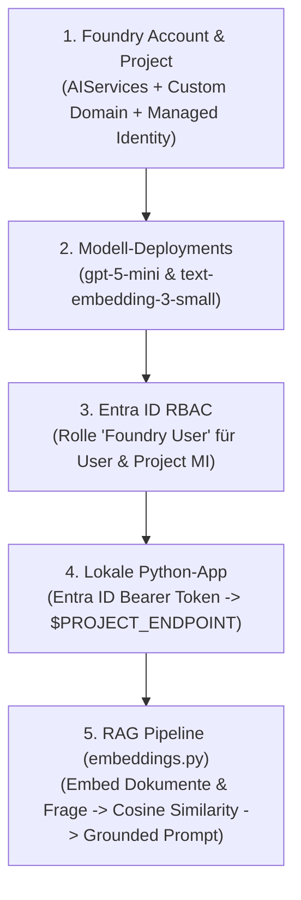

# DevSecOps 15: AI in Azure (Azure AI Foundry, Entra ID RBAC & RAG)

Themenschwerpunkte dieser Session sind die sichere Bereitstellung und Nutzung generativer KI-Dienste in Azure mittels **Azure AI Foundry (`AIServices`)**. Der Fokus liegt auf einer **schlüssellosen Authentifizierung (Keyless Auth)** über **Microsoft Entra ID RBAC** (`Foundry User`), **System-Assigned Managed Identities**, der Bereitstellung von LLM- und Embedding-Modellen (`gpt-5-mini`, `text-embedding-3-small`) sowie der Implementierung eines lokalen **Retrieval-Augmented Generation (RAG)**-Prototyps in Python.

---

## Übersicht der Dateien

| Datei | Beschreibung |
| --- | --- |
| [`00_env_variables.sh`](./00_env_variables.sh) | Zentrale Umgebungsvariablen (`RG`, `LOC`, `FOUNDRY`, `PROJECT`, `MODEL`) |
| [`01_register_provider_and_rg.sh`](./01_register_provider_and_rg.sh) | Registrierung von `Microsoft.CognitiveServices` und Erstellung der Resource Group |
| [`02_create_foundry_and_project.sh`](./02_create_foundry_and_project.sh) | Bereitstellung des Azure AI Foundry Accounts (`AIServices`, `--custom-domain`, Managed Identity) und Projekts |
| [`03_deploy_llm_model.sh`](./03_deploy_llm_model.sh) | Abfrage verfügbarer Modellversionen/SKUs und Deployment von `gpt-5-mini` (`DataZoneStandard`) |
| [`04_assign_rbac_roles.sh`](./04_assign_rbac_roles.sh) | Ermittlung der Resource-/Principal-IDs und Zuweisung der RBAC-Rolle `Foundry User` für User & Project Managed Identity |
| [`05_get_project_endpoint.sh`](./05_get_project_endpoint.sh) | Auslesen und Exportieren der projektspezifischen `AI Foundry API`-URL (`PROJECT_ENDPOINT`) |
| [`06_setup_local_python_env.sh`](./06_setup_local_python_env.sh) | Anlage von `ai_foundary_demo_devsecops_15/`, Python-`venv` und Installation von `azure-ai-projects` & `azure-identity` |
| [`07_create_and_run_ask_ai.sh`](./07_create_and_run_ask_ai.sh) | Erstellung und Ausführung von `ask_ai.py` via `AIProjectClient` und `DefaultAzureCredential` |
| [`08_deploy_embedding_model.sh`](./08_deploy_embedding_model.sh) | Deployment des Embedding-Modells `text-embedding-3-small` (`GlobalStandard`) |
| [`09_setup_and_run_embeddings_rag.sh`](./09_setup_and_run_embeddings_rag.sh) | Installation von `openai` & `numpy`, Erstellung und Ausführung von `embeddings.py` (Cosine-Similarity-RAG) |
| [`10_list_deployments.sh`](./10_list_deployments.sh) | Tabellarische Auflistung aller aktiven Modell-Deployments im Foundry Account |
| [`11_cleanup.sh`](./11_cleanup.sh) | *(Optional)* Asynchrones Löschen der Resource Group (`az group delete`) zur Kostenvermeidung |

---

## Architektur & Sicherheitskonzepte

### 1. Schlüssellose Authentifizierung (Entra ID RBAC statt API-Keys)
Anstatt statische API-Keys (`AZURE_OPENAI_API_KEY`) im Code oder in `.env`-Dateien zu speichern, nutzt dieses Setup durchgängig **Microsoft Entra ID**:
- `--custom-domain $FOUNDRY`: Zwingende Voraussetzung bei `AIServices`, damit Entra-ID-Tokens gegen einen eindeutigen Subdomain-Endpoint akzeptiert werden.
- **RBAC-Rolle `Foundry User`**: Sowohl der angemeldete Entwickler (`USER_ID`) als auch die System-Assigned Managed Identity des Projekts (`PROJECT_MI`) erhalten ausschließlich die benötigte Rolle auf Account-Ebene (`$FOUNDRY_ID`).
- **Token-Abruf in Python**:
  - `AIProjectClient` nutzt `DefaultAzureCredential()` (verwendet lokal automatisch die aktive `az login`-Session, in Azure die Managed Identity).
  - Der native `OpenAI`-Client nutzt `get_bearer_token_provider(AzureCliCredential(), "https://ai.azure.com/.default")`, sodass kurzlebige OAuth2-Bearer-Tokens automatisch erneuert werden.

### 2. Ablauf: Provisioning bis RAG-Inference

### 3. Data Governance & RAG-Grounding
- **`DataZoneStandard` SKU (`gpt-5-mini`)**: Ermöglicht die Verarbeitung innerhalb definierter Datenzonen (z. B. EU/Deutschland bei `germanywestcentral`), was für Compliance-Anforderungen (DSGVO) relevant ist.
- **Kontextbindung gegen Halluzinationen**: In `embeddings.py` werden zunächst die Vektor-Embeddings kleiner Unternehmensrichtlinien berechnet. Anhand der **Cosine Similarity** wird nur das relevanteste Dokument ausgewählt und über `instructions="Answer only based on the provided context."` als verbindlicher Kontext an das LLM übergeben.
