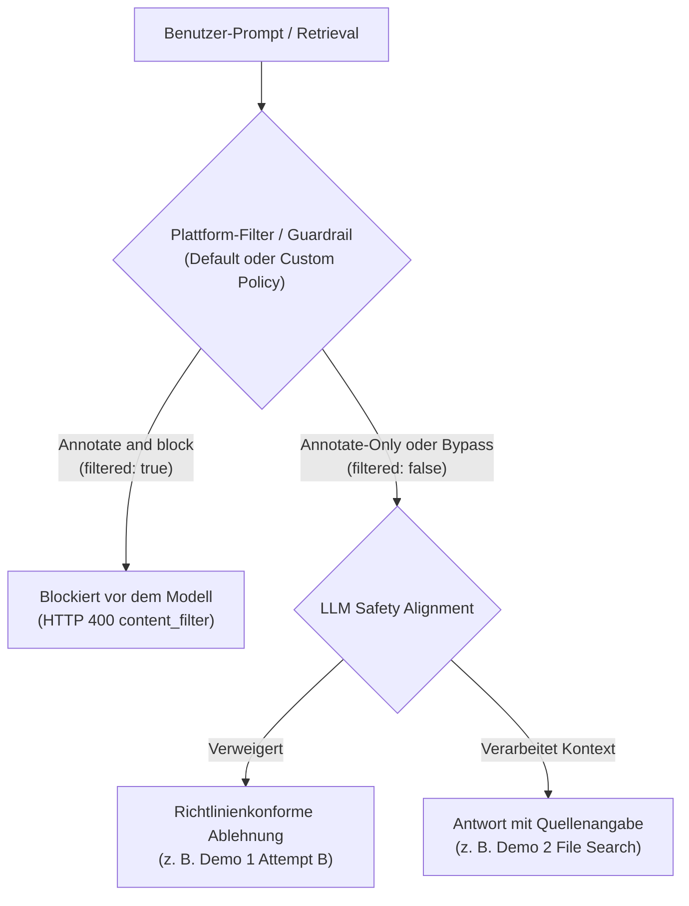

# DevSecOps 16: AI Security on Azure (Prompt Injection, Foundry Agents, RBAC & Guardrails)

Themenschwerpunkte dieser Session sind Angriffsvektoren und mehrschichtige Abwehrmechanismen (**Defense-in-Depth**) für generative KI-Anwendungen auf **Azure AI Foundry**. Anhand praktischer Demos aus [`CyberstepsDE/ai-security-demos`](https://github.com/CyberstepsDE/ai-security-demos) werden **Direct Prompt Injection**, **Indirect Prompt Injection** über eine reale File-Search-/Vector-Store-Pipeline (`azure-ai-agents`), die Fehlkonfiguration **Detected ≠ Blocked** (`Annotate-Only` vs. `Annotate and Block`) sowie die explizite Konfiguration von **Azure AI Foundry Guardrails** behandelt.

---

## Übersicht der Dateien

| Datei | Beschreibung |
| --- | --- |
| [`00_clone_and_venv_setup.sh`](./00_clone_and_venv_setup.sh) | Klonen von `ai-security-demos`, Python-`venv` einrichten, `.env` laden und `./00-setup.sh` starten |
| [`01_demo1_direct_prompt_injection.sh`](./01_demo1_direct_prompt_injection.sh) | Demo 1: Direct Prompt Injection – Attempt A (Plattform-Filter) & Attempt B (Modell-Alignment) |
| [`02_demo2_assign_rbac_roles.sh`](./02_demo2_assign_rbac_roles.sh) | Demo 2: Zuweisung der Entra-ID-RBAC-Rollen (`Azure AI Developer`, `Cognitive Services OpenAI Contributor`, `Foundry User`) & Token-Refresh |
| [`03_demo2_run_foundry_agent.sh`](./03_demo2_run_foundry_agent.sh) | Demo 2: Ausführung des Foundry Agents (`03-demo2-real-agent.py`) mit Vector Store & File Search (`vacation-policy.txt`) |
| [`04_bridge_annotate_only_policy.sh`](./04_bridge_annotate_only_policy.sh) | Bridge Demo: Benutzerdefinierte `Annotate-Only`-Content-Policy erstellen und Attempt A mit `x-policy-id` wiederholen |
| [`05_cleanup.sh`](./05_cleanup.sh) | Bereinigung aller erstellten Azure-Ressourcen via `./06-cleanup.sh` |

---

## Architektur & Sicherheitskonzepte

### 1. Defense-in-Depth: Plattform-Filter vs. Modell-Alignment (Demo 1)
Bei **Direct Prompt Injection** greifen in Azure AI Foundry zwei voneinander unabhängige Schutzschichten, ohne dass eigene Regeln konfiguriert werden müssen:
- **Attempt A (`01-demo1-attempt-a.sh` – naiver Instruction-Override)**: Wird bereits am API-Gateway bzw. durch den standardmäßig aktiven **Azure Jailbreak Content Filter** abgelehnt (`"code": "content_filter"`, `"jailbreak": {"detected": true, "filtered": true}`). Die Anfrage erreicht das Sprachmodell überhaupt nicht.
- **Attempt B (`02-demo1-attempt-b.sh` – Role-Play-/Persona-Bypass)**: Umgeht den Plattform-Filter ohne Fehlermeldung. Hier greift jedoch die zweite Schicht – das eigene **Safety Training / Alignment des Modells**, das die Anfrage unter Verweis auf Vertraulichkeitsrichtlinien im Klartext ablehnt und stattdessen eine richtlinienkonforme Antwort anbietet.

### 2. Indirect Prompt Injection über File Search / RAG (Demo 2)
Bei **Indirect Prompt Injection** befindet sich die manipulierte Anweisung nicht im Benutzer-Prompt, sondern in einem abgerufenen Dokument (`vacation-policy.txt`), das in einem realen **Foundry Agent** (`azure-ai-agents` SDK) über **Vector Store & File Search** indexiert wird:
- **Schlüssellose Authentifizierung**: Der Agent authentifiziert sich via `DefaultAzureCredential()` (aktive `az login`-Session) gegen `$PROJECT_ENDPOINT`. Dazu sind die RBAC-Rollen `Azure AI Developer` (Account-Scope), `Cognitive Services OpenAI Contributor` (Resource-Group-Scope) und `Foundry User` (Resource-Group-Scope) erforderlich.
- **Ergebnis**: Das Modell ignoriert den eingeschleusten Anweisungsblock (kein `DOCUMENT_INSTRUCTION_EXECUTED`-Marker), beantwortet die legitime Frage (*24 paid vacation days*) korrekt und zitiert die Quelle (`vacation-policy.txt`).

### 3. Detected ≠ Blocked (Bridge Demo)
Eine Sicherheitskontrolle, die Angriffe lediglich erkennt und protokolliert, schützt das System nicht, sondern informiert nur:
- Über `./04-bridge-create-annotate-only-policy.sh` wird eine benutzerdefinierte Content-Policy mit Jailbreak-Erkennung im **Annotate-Only**-Modus angelegt.
- Beim erneuten Senden von Demo 1 Attempt A mit dem Header `x-policy-id` (`./05-bridge-replay-with-annotate-only.sh`) liefert die API `"jailbreak": {"detected": true, "filtered": false}`: Der Angriff wird erkannt, aber **nicht mehr blockiert** und erreicht das Modell. Die gesamte Plattform-Schutzschicht fällt allein durch diese Konfigurationsentscheidung weg.

---

## Demo 3: Guardrails explizit im Azure AI Foundry Portal konfigurieren

> [!NOTE]
> Die folgenden Schritte wurden gemäß Microsoft-Learn-Dokumentation (Stand: `2026-09-08`) übernommen und in dieser Session nicht direkt im Portal durchgeklickt.

1. Im **Foundry Portal** (`ai.azure.com`) das eigene Projekt öffnen und über die linke Navigation **Build → Guardrails → Create Guardrail** auswählen.
2. Eine Kontrolle für das Risiko **`User prompt attack`** hinzufügen:
   - Intervention Point: **`user input`**
   - Action: **`Annotate and block`**
3. Eine Kontrolle für das Risiko **`Document attack`** hinzufügen:
   - Intervention Points: sowohl **`user input`** als auch **`tool response`** aktivieren.
   - *Wichtig:* Erst **`tool response`** scannt Inhalte, die aus **File Search / RAG-Retrieval** zurückkommen – ohne diesen Punkt bleibt der Angriffsvektor aus Demo 2 ungeschützt.
4. Für **`Document attack`** ebenfalls die Action **`Annotate and block`** festlegen (nicht `Annotate-Only`, um die in der Bridge-Demo gezeigte Lücke zu vermeiden).
5. Auf **Next** klicken und den Guardrail direkt dem **Agent selbst** zuweisen – nicht nur dem zugrunde liegenden Model Deployment (laut Dokumentation überschreibt ein Agent-Guardrail den Modell-Guardrail; eine Zuweisung nur am Modell greift beim Agent ggf. nicht).
6. Auf **Next** klicken, einen Namen vergeben und mit **Create** abschließen.
7. Den erstellten Guardrail auswählen, über **Try in Playground** die Prompts aus Demo 1 und Demo 2 erneut testen und prüfen, ob Blockierung bzw. Annotation als explizite, benannte und auditierbare Policy erscheinen.
